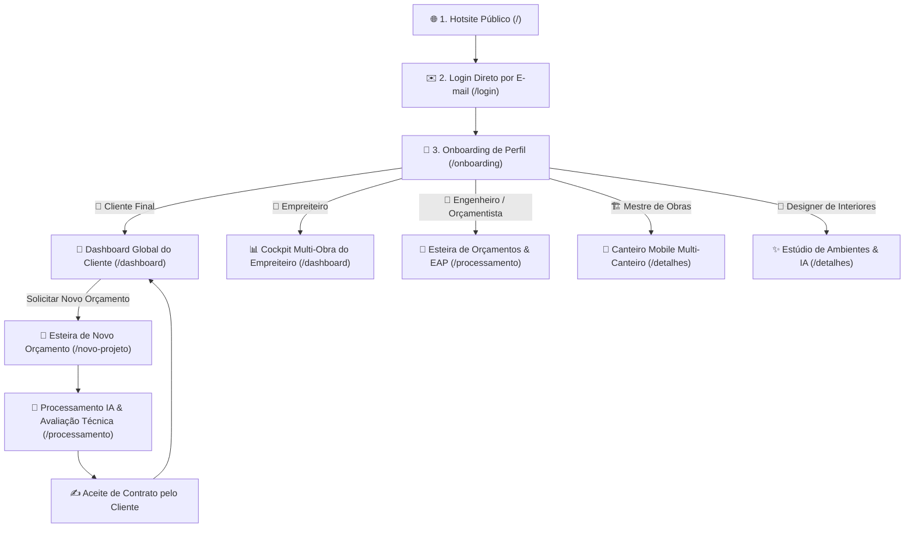
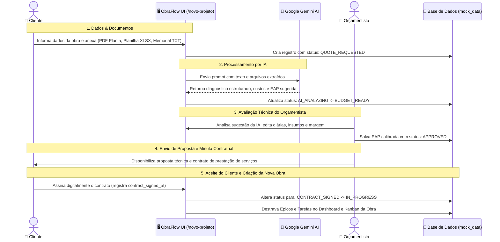

# Arquitetura de Jornadas do Usuário e Telas do ObraFlow (`JOURNEYS.md`)

Este documento define a **arquitetura de interface, navegação e a experiência visual completa** da aplicação sob a perspectiva de cada um dos **cinco perfis de usuário** do ecossistema **ObraFlow**, detalhando também a esteira de ponta a ponta do **Processo de Novo Orçamento com IA**.

---

## 🧭 1. Fluxo Macro de Acesso e Roteamento

O acesso ao sistema inicia pelo Hotsite, passa pela autenticação direta por e-mail e obrigatoriamente pela **etapa de Onboarding**, onde o usuário escolhe seu perfil antes de acessar seu **Dashboard Global**:



---

## 🚪 2. Telas de Entrada: Login e Onboarding

### 2.1. Tela de Login Limpa e Direta (`/login`)

> **Regra de Negócio:** Acesso simplificado exclusivamente por e-mail (envio de link mágico ou código OTP), sem login social do Google ou carteiras Web3.

```
+----------------------------------------------------------------------------------------+
|                                      OBRAFLOW 🏗️⚡                                     |
|                                                                                        |
|                             Acesse a sua gestão de obras                              |
|                                                                                        |
|                      +------------------------------------------+                      |
|                      |  [ ✉️ ] Digite seu e-mail corporativo    |                      |
|                      +------------------------------------------+                      |
|                      |  [ Entrar com E-mail → ]                 |                      |
|                      +------------------------------------------+                      |
|                                                                                        |
|                       🔒 Acesso corporativo seguro via link mágico                     |
+----------------------------------------------------------------------------------------+
```

---

### 2.2. Tela de Onboarding de Perfil (`/onboarding`)

> **Regra de Negócio:** Após autenticar o e-mail, o usuário acessa esta tela onde seleciona com qual perfil atuará na sessão, definindo o painel e os dados que serão exibidos.

```
+----------------------------------------------------------------------------------------+
| [🏗️ ObraFlow]                                                 Usuário: marina@email.com|
+----------------------------------------------------------------------------------------+
|                                                                                        |
|                              BEM-VINDO AO OBRAFLOW! 👋                                 |
|                   Selecione seu perfil para configurar sua experiência                 |
|                                                                                        |
|  +------------------------+  +------------------------+  +--------------------------+  |
|  | 👤 CLIENTE PROPRIETÁRIO|  | 🏢 EMPREITEIRO / GESTOR|  | 📐 ENGENHEIRO ORÇAMENTISTA|  |
|  |                        |  |                        |  |                          |  |
|  | • Acompanhe suas obras |  | • Cockpit multi-obra   |  | • Esteira de projetos   |  |
|  | • Solicite orçamentos  |  | • Termômetro físico x R$| • Leitura de PDF/XLSX IA |  |
|  | • Comprovação por fotos|  | • Alerta de compras    |  | • Estruturação de EAP    |  |
|  | • Simulações com IA    |  | • Folha e fluxo caixa  |  | • Composição de custos   |  |
|  |                        |  |                        |  |                          |  |
|  | [ Entrar como Cliente ]|  | [ Entrar como Gestor ] |  | [ Iniciar Orçamento ]    |  |
|  +------------------------+  +------------------------+  +--------------------------+  |
|                                                                                        |
|              +--------------------------+  +--------------------------+                |
|              | 🏗️ MESTRE DE OBRAS       |  | 🎨 DESIGNER DE INTERIORES|                |
|              |                          |  |                          |                |
|              | • Seus canteiros de hoje |  | • Estúdio de acabamentos |                |
|              | • Checklist de execução  |  | • Simulações no cômodo IA|                |
|              | • Recebimento de cargas  |  | • Marcenaria e luz       |                |
|              | • Envio obrigatório foto |  | • Aprovações com cliente |                |
|              |                          |  |                          |                |
|              | [ Acessar Canteiro ]     |  | [ Abrir Estúdio IA ]     |                |
|              +--------------------------+  +--------------------------+                |
|                                                                                        |
+----------------------------------------------------------------------------------------+
```

---

## 📝 3. O Processo de Novo Orçamento (Esteira de 5 Etapas)

O processo de criação de um novo orçamento é a porta de entrada para transformar uma intenção do cliente em uma **obra oficial cadastrada e em execução (`IN_PROGRESS`)**. Ele opera através de uma esteira colaborativa em 5 etapas entre **Cliente**, **IA (Google Gemini)** e **Orçamentista/Engenheiro**.

### 3.1. Diagrama de Sequência do Processo


---

### 3.2. Wireframes Detalhados das 5 Sub-Etapas de Orçamento

#### Sub-Etapa 1: Preenchimento de Dados e Upload de Documentos (`/novo-projeto`)
> **Quem executa:** Cliente Proprietário ou Orçamentista.  
> **Objetivo:** Inserir os parâmetros básicos da obra e enviar a documentação técnica heterogênea.

```
+----------------------------------------------------------------------------------------+
| [🏗️ ObraFlow]  Novo Orçamento de Obra / Reforma                Etapa: [ 1 de 5: Dados ]|
+----------------------------------------------------------------------------------------+
|                                                                                        |
|  1. DADOS BÁSICOS DO IMÓVEL                                                            |
|  Nome da Obra:       [ Reforma Loft Jardins                                    ]       |
|  Endereço Canteiro:  [ Alameda dos Anapurus, 780 - Apto 82                     ]       |
|  Área Estimada (m²): [ 72        ]     Teto Orçamentário Máximo: [ R$ 45.000,00 ]      |
|  Escopo Preliminar:  [ Reforma completa de loft: integração cozinha, piso porcelanato ]|
|                                                                                        |
| -------------------------------------------------------------------------------------- |
|  2. DOCUMENTAÇÃO TÉCNICA DA OBRA (ARQUIVOS OBRIGATÓRIOS)                               |
|                                                                                        |
|  +---------------------------+ +---------------------------+ +-----------------------+ |
|  | 📄 PLANTA EXECUTIVA (PDF) | | 📊 PLANILHA CUSTOS (XLSX) | | 📝 MEMORIAL (TXT)     | |
|  | [ Arraste ou Selecione ]  | | [ Arraste ou Selecione ]  | | [ Arraste ou Selecione| |
|  |                           | |                           | |                       | |
|  | ✔️ planta_loft.pdf (2.4MB)| | ✔️ sinapi_loft.xlsx(840KB)| | ✔️ memorial.txt(45KB) | |
|  +---------------------------+ +---------------------------+ +-----------------------+ |
|                                                                                        |
|  Status Inicial do Projeto: [ QUOTE_REQUESTED ]                                        |
|  [ Cancelar ]                                   [ Enviar para Processamento IA → ]     |
+----------------------------------------------------------------------------------------+
```

---

#### Sub-Etapa 2: Processamento e Extração de Quantitativos pela IA (`/processamento`)
> **Quem executa:** Motor de IA (Google Gemini API).  
> **Objetivo:** Ler simultaneamente os 3 formatos de arquivos técnicos, cruzar plantas com quantitativos e sugerir o orçamento base com decomposição em macroetapas.

```
+----------------------------------------------------------------------------------------+
| [🏗️ ObraFlow]  Processamento Inteligente por IA               Etapa: [ 2 de 5: IA ]   |
+----------------------------------------------------------------------------------------+
|                                                                                        |
|  🤖 AGENTE TÉCNICO DE ENGENHARIA (GOOGLE GEMINI API)                                   |
|  Status da Chamada: [ ⚡ Processamento Concluído com Sucesso ] | Confiança: [ 94% ]    |
|                                                                                        |
|  +----------------------------------------------------------------------------------+  |
|  | DIAGNÓSTICO PRELIMINAR EXTRAÍDO:                                                 |  |
|  | "Reforma de 72m² em ambiente residencial. Não foram identificadas intervenções    |  |
|  | estruturais em pilares/vigas. Demolição de mureta divisória com geração de 3m³ de |  |
|  | entulho. Necessidade de 65m² de piso porcelanato e novo circuito 220V para ilha."|  |
|  +----------------------------------------------------------------------------------+  |
|                                                                                        |
|  Orçamento Base Sugerido pela IA: [ R$ 43.500,00 ] (Dentro do teto do cliente de R$ 45k)|
|  Status do Projeto Atualizado: [ BUDGET_READY ]                                        |
|                                                                                        |
|  [ 🔄 Reexecutar com Novo Prompt ]              [ Encaminhar para o Orçamentista → ]   |
+----------------------------------------------------------------------------------------+
```

---

#### Sub-Etapa 3: Avaliação Técnica e Ajuste pelo Orçamentista
> **Quem executa:** Engenheiro / Orçamentista.  
> **Objetivo:** Auditar os itens gerados pela IA, calibrar valores de diárias locais, quantidades de materiais e margem de contingência antes de gerar a proposta oficial.

```
+----------------------------------------------------------------------------------------+
| [🏗️ ObraFlow]  Auditoria e Composição da EAP pelo Orçamentista  Etapa: [ 3 de 5: EAP ] |
+----------------------------------------------------------------------------------------+
|                                                                                        |
|  📐 REVISÃO TÉCNICA DA ESTRUTURA ANALÍTICA DE PROJETO (EAP)                            |
|                                                                                        |
|  Tarefa Proposta pela IA              | Cat.     | Prazo Limite | Mão Obra | Insumos  |
|  -------------------------------------+----------+--------------+----------+--------- |
|  1. Demolição de Alvenaria e Remoção  | EXEC     | [28/10/2026] | R$ 2.200 | R$   400 |
|  2. Readequação de Circuitos Elétricos| EXEC     | [30/10/2026] | R$ 1.800 | R$ 1.200 |
|  3. Recebimento de Porcelanato 120x120| RECEIVING| [03/11/2026] | R$   300 | R$     0 |
|  4. Assentamento Porcelanato Social   | EXEC     | [12/11/2026] | R$ 4.200 | R$ 9.800 |
|  5. Instalação Drywall e Trilhos LED  | EXEC     | [24/11/2026] | R$ 2.600 | R$ 3.500 |
|                                                                                        |
|  Total Mão de Obra: R$ 11.100,00  |  Total Materiais: R$ 14.900,00  |  Fretes: R$ 850  |
|  VALOR FINAL HOMOLOGADO DA EAP: [ R$ 44.200,00 ]   Status: [ APPROVED ]                |
|                                                                                        |
|  [ + Adicionar Insumo/Tarefa ]              [ Gerar Proposta Comercial & Contrato → ]  |
+----------------------------------------------------------------------------------------+
```

---

#### Sub-Etapa 4: Envio da Proposta Comercial e Minuta Contratual
> **Quem executa:** Orçamentista / Construtora enviando para o Cliente.  
> **Objetivo:** Formalizar a proposta com cronograma de pagamento vinculado a vistorias e evidências fotográficas.

```
+----------------------------------------------------------------------------------------+
| [🏗️ ObraFlow]  Envio de Proposta Comercial e Minuta           Etapa: [ 4 de 5: Envio ]|
+----------------------------------------------------------------------------------------+
|                                                                                        |
|  📜 RESUMO DA PROPOSTA A SER ENVIADA AO CLIENTE:                                       |
|  • Cliente: Marina Costa (marina.costa@email.com)                                      |
|  • Obra: Reforma Loft Jardins (Alameda dos Anapurus, 780 - 72m²)                        |
|  • Valor Fechado da EAP: R$ 44.200,00                                                  |
|  • Condições de Pagamento:                                                             |
|    - Sinal de Mobilização (Assinatura): R$ 20.000,00                                   |
|    - Parcela 2 (Medição Porcelanato c/ Foto): R$ 14.200,00                             |
|    - Parcela 3 (Entrega de Gesso e Iluminação c/ Foto): R$ 10.000,00                  |
|                                                                                        |
|  • Cláusula Pétrea de Evidência: A liberação das parcelas só ocorre após envio de foto|
|    comprovando a conclusão no canteiro pelo Mestre de Obras.                           |
|                                                                                        |
|  [ ✉️ Disparar Notificação e Contrato para o Cliente Aceitar Digitalmente ]             |
+----------------------------------------------------------------------------------------+
```

---

#### Sub-Etapa 5: Aceite do Cliente e Ativação Oficial da Nova Obra
> **Quem executa:** Cliente Final assinando digitalmente.  
> **Objetivo:** O cliente aceita o orçamento e os termos, mudando o status para `CONTRACT_SIGNED` $\rightarrow$ `IN_PROGRESS`, criando a obra ativa no Dashboard Global.

```
+----------------------------------------------------------------------------------------+
| [🏗️ ObraFlow]  Revisão da Proposta e Assinatura Digital       Etapa: [ 5 de 5: Aceite]|
+----------------------------------------------------------------------------------------+
|                                                                                        |
|  CONTRATO DE PRESTAÇÃO DE SERVIÇOS — REFORMA LOFT JARDINS                              |
|  Valor Total Contratado: R$ 44.200,00 | Prazo Estimado: 45 dias corridos               |
|                                                                                        |
|  +----------------------------------------------------------------------------------+  |
|  | TERMO DE ACEITE E COMPROMISSO DE TRANSPARÊNCIA:                                  |  |
|  | [X] Eu, Marina Costa, aprovo o orçamento técnico, a lista de insumos da EAP e o   |  |
|  |     cronograma físico-financeiro com vistorias por evidência fotográfica.         |  |
|  +----------------------------------------------------------------------------------+  |
|                                                                                        |
|  Registro de Assinatura: contract_signed_at = 25/10/2026 09:00:12 (did:privy:cl_marina)|
|  Status da Obra: [ CONTRACT_SIGNED ] ➔ [ 🚀 IN_PROGRESS ]                               |
|                                                                                        |
|  [ ✅ CONFIRMAR ACEITE E CADASTRAR NOVA OBRA NO SISTEMA ]                               |
|  (A obra aparecerá automaticamente na lista de canteiros ativos do Dashboard Global)   |
+----------------------------------------------------------------------------------------+
```

---

## 📊 4. Dashboards Globais por Perfil (Seguindo o Modelo Oficial de Dashboard)

Todos os painéis seguem a estrutura padrão:
1. **Header com Seletor e Botão de Ação Primária**
2. **Faixa de BigValues (4 Números-Chave Estratégicos)**
3. **Master Pipeline / Linha do Tempo**
4. **Gráfico Analítico Central**
5. **Quadro Kanban Polimórfico**
6. **DataTable Operacional Detalhado**

---

### 4.1. 👤 Dashboard Global do Cliente Final / Proprietário

O Cliente Final tem uma visão focada em **transparência, evolução física e facilidade para orçar novas reformas**.

#### Indicadores Pertinentes:
* **Total Investido (R$):** Soma do valor dos contratos das suas obras.
* **% Avanço Físico Médio:** Progresso das obras comprovado estritamente por fotos de campo.
* **Fotos de Vistorias:** Evidências fotográficas auditadas do canteiro.
* **Obras Cadastradas:** Quantidade de imóveis sob gestão.

#### Wireframe Visual do Dashboard do Cliente (`/dashboard` — Modo Cliente):
```
+----------------------------------------------------------------------------------------+
| [🏗️ ObraFlow]  Minhas Obras & Reformas                       [ + Solicitar Novo Orçamento ]|
| Obra Ativa: [ Residencial Alpha (em andamento) v ]                Perfil: [👤 Cliente] |
+----------------------------------------------------------------------------------------+
|                                                                                        |
|  [ R$ 118.850,00 ]          [ 48% ]                 [ 6 Fotos ]             [ 2 Obras ]|
|  Total Orçado Investido     Avanço Físico c/ Foto   Vistorias Validadas     Em Andamento|
|                                                                                        |
| -------------------------------------------------------------------------------------- |
| 📅 STATUS DAS SUAS OBRAS (MASTER PIPELINE)                                             |
|                                                                                        |
| 🏠 Residencial Alpha (Rua das Palmeiras, 123)                                          |
| [████████████████████] 62% Concluído | Construtora: Alpha Eng. | [ Ver Detalhes → ]    |
| • 1. Estrutura: ✅ Concluída  |  2. Alvenaria: 🚧 Em Andamento  |  3. Acabamento: 🔒 Aguard.|
|                                                                                        |
| 🏢 Reforma Loft Jardins (Alameda dos Anapurus, 780)                                    |
| [██████              ] 15% Concluído | Construtora: Alpha Eng. | [ Ver Detalhes → ]    |
| • 1. Demolição: ✅ Concluída  |  2. Revestimentos: 🚧 Em Andamento                      |
|                                                                                        |
| -------------------------------------------------------------------------------------- |
| 📸 FOTOS RECENTES DO CANTEIRO DE OBRAS                                                 |
| +---------------------+ +---------------------+ +---------------------+                |
| | 📷 Foto: Alvenaria  | | 📷 Foto: Tubulações | | 📷 Foto: Concretagem|                |
| | Residencial Alpha   | | Residencial Alpha   | | Residencial Alpha   |                |
| | 📅 18/10 por Mestre | | 📅 22/10 por Roberto| | 📅 25/09 por Mestre |                |
| +---------------------+ +---------------------+ +---------------------+                |
|                                                                                        |
| -------------------------------------------------------------------------------------- |
| ✨ SIMULAÇÕES DE ACABAMENTOS POR INTELIGÊNCIA ARTIFICIAL                                |
| • Cozinha Integrada: Bancada em Quartzo Branco + Cuba Gourmet [ ✅ Aprovado por Você ] |
| • Living e Jantar: Porcelanato Retificado Calacata 90x90cm   [ ✅ Aprovado por Você ] |
| • Sala de Jantar: Pendente Linear Dourado LED                [ ⏳ Em Análise ]         |
|                                                                                        |
| [ Ver Antes x Depois com IA ]  [ Falar com o Engenheiro Responsável ]                  |
+----------------------------------------------------------------------------------------+
```

---

### 4.2. 🏢 Dashboard Global do Empreiteiro / Construtora (Gestor)

O Empreiteiro precisa de **controle financeiro rigoroso, margem líquida consolidada e prevenção de gargalos operacionais**.

#### Indicadores Pertinentes:
* **Faturamento da Carteira:** Valor contratado de todas as obras em execução.
* **Margem Líquida em Caixa:** Total recebido do cliente menos custos operacionais pagos.
* **Desvio Médio Físico x Financeiro:** Diagnóstico de adiantamento de compras.
* **Alertas de Suprimentos:** Materiais essenciais que vencem em $\le 7$ dias.

#### Wireframe Visual do Dashboard do Empreiteiro (`/dashboard` — Modo Gestor):
```
+----------------------------------------------------------------------------------------+
| [🏗️ ObraFlow]  Cockpit Multi-Obra do Empreiteiro            [ + Cadastrar Nova Obra ]  |
| Visão: [ 📊 Portfólio Geral v ]                             Perfil: [🏢 Empreiteiro]   |
+----------------------------------------------------------------------------------------+
|                                                                                        |
|  [ R$ 118.850,00 ]        [ R$ 44.320,00 ]          [ +13% ]               [ 🚨 1 ]     |
|  Carteira Total           Margem Atual Caixa        Desvio Físico x Fin.   Gargalo Compra|
|                                                                                        |
| -------------------------------------------------------------------------------------- |
| 📊 COMPARATIVO DE SAÚDE POR CANTEIRO (TERMÔMETRO FÍSICO x FINANCEIRO)                  |
|                                                                                        |
| • Residencial Alpha:  Físico: [█████████████       ] 62% | Financ: [███████████████    ] 75% |
| • Reforma Loft:       Físico: [███                 ] 15% | Financ: [████               ] 20% |
|                                                                                        |
| -------------------------------------------------------------------------------------- |
| 🚨 ALERTA DE COMPRAS CRÍTICAS (SUPPLY CHAIN)                                           |
| Material: Bancada Ilha Cozinha Quartzo | Obra: Residencial Alpha | Vence em 2 dias      |
| [ Comprar Imediatamente ]  [ Negociar Prazo com Fornecedor ]                          |
|                                                                                        |
| -------------------------------------------------------------------------------------- |
| 📋 QUADRO KANBAN MULTI-OBRA                                                            |
| Filtro: [ Todas as Obras ] [ 🧱 Execução ] [ 📦 Recebimento ] [ 🛒 Compras ]            |
| +------------------+ +------------------+ +------------------+ +---------------------+ |
| | TODO (4)         | | IN PROGRESS (3)  | | REVIEW / CONF (2)| | DONE (7 c/ Foto)     | |
| | • Assentar Piso  | | • Teste Pressão  | | • Receber Porcel.| | • Concretagem S1..S8 | |
| | • Trilhos LED    | | • Compra Bancada | | • Receber Cimento| | • Alvenaria Cozinha  | |
| +------------------+ +------------------+ +------------------+ +---------------------+ |
|                                                                                        |
| -------------------------------------------------------------------------------------- |
| 💰 EXTRATO FINANCEIRO & FLUXO DE CAIXA CONSOLIDADO                                     |
| Total Recebido: R$ 100.000,00  |  Despesas Pagas: R$ 55.680,00  |  Saldo: R$ 44.320,00 |
| [ Gerar Folha de Pagamento ]  [ Auditar Transações ]  [ Exportar Relatório DRE ]       |
+----------------------------------------------------------------------------------------+
```

---

### 4.3. 📐 Dashboard Global do Engenheiro / Orçamentista

O Engenheiro orçamentista atua na **leitura inteligente de documentos por IA, composição de preços e desdobramento da EAP**.

#### Indicadores Pertinentes:
* **Projetos em Análise:** Documentos aguardando leitura pelo agente de IA.
* **Total Orçado em EAPs Aprovadas:** Volume financeiro já estruturado.
* **Índice Médio de Confiança da IA:** Acurácia da extração documental.
* **Tarefas Mapeadas:** Total de tarefas atômicas cadastradas com peso na EAP.

#### Wireframe Visual do Dashboard do Orçamentista (`/processamento`):
```
+----------------------------------------------------------------------------------------+
| [🏗️ ObraFlow]  Esteira de Projetos e Orçamentos        [ + Novo Orçamento com IA ]    |
| Projeto Selecionado: [ Reforma Loft Jardins (72m²) v ]        Perfil: [📐 Orçamentista]|
+----------------------------------------------------------------------------------------+
|                                                                                        |
|  [ 1 Projeto ]             [ R$ 118.850,00 ]         [ 95% ]                [ 16 ]     |
|  Em Leitura IA             EAPs Aprovadas            Confiança Média IA     Tarefas EAP|
|                                                                                        |
| -------------------------------------------------------------------------------------- |
| 📂 ESTEIRA DE DOCUMENTOS TÉCNICOS INGERIDOS                                            |
| Planta Executiva (PDF) | Planilha Orçamentária (XLSX) | Memorial Descritivo (TXT)      |
| [ ⚡ Executar Extração com Google Gemini API ]  [ Inspecionar Diagnóstico em JSON ]    |
|                                                                                        |
| -------------------------------------------------------------------------------------- |
| 🏗️ ESTRUTURA ANALÍTICA DE PROJETO (EAP) GERADA PELA IA — REVISÃO E EDIÇÃO             |
|                                                                                        |
| Tarefa                                | Categoria     | Prazo Limite | Mão de Obra (R$)|
| -------------------------------------+---------------+--------------+----------------- |
| 1. Demolição de Mureta e Entulho     | EXECUTION     | [28/10/2026] | [ R$ 2.200,00 ] |
| 2. Readequação de Pontos Elétricos   | EXECUTION     | [30/10/2026] | [ R$ 1.800,00 ] |
| 3. Recebimento de Porcelanato 120x120 | RECEIVING     | [03/11/2026] | [ R$   300,00 ] |
| 4. Assentamento Porcelanato Social   | EXECUTION     | [12/11/2026] | [ R$ 4.200,00 ] |
|                                                                                        |
| Subtotal Mão de Obra: R$ 8.500,00 | Subtotal Insumos: R$ 22.400,00 | Total: R$ 43.500,00|
| [ + Adicionar Nova Tarefa ]  [ Aprovar EAP e Enviar para Minuta Contratual → ]         |
+----------------------------------------------------------------------------------------+
```

---

### 4.4. 🏗️ Dashboard Global do Mestre de Obras / Campo (Mobile First)

O Mestre de Obras utiliza uma interface **leve, responsiva para celular e focada em tarefas de hoje e fotos obrigatórias**.

#### Indicadores Pertinentes:
* **Tarefas de Hoje:** Atividades com prazo de entrega hoje.
* **Cargas a Receber:** Entregas de fornecedores previstas para o canteiro.
* **Fotos Auditadas no Mês:** Tarefas concluídas e comprovadas com imagem.
* **Equipe em Campo:** Colaboradores alocados no canteiro.

#### Wireframe Visual do Dashboard de Campo (`/detalhes` — Modo Mobile):
```
+------------------------------------------+
| 🏗️ ObraFlow Campo      👷 Mestre José    |
| Canteiro: [ Residencial Alpha v ]        |
+------------------------------------------+
|                                          |
|  [ 2 ]            [ 1 Carga ]     [ 5 ]  |
|  Tarefas Hoje     A Conferir      Fotos OK|
|                                          |
| ---------------------------------------- |
| 🧱 MINHAS TAREFAS DE EXECUÇÃO HOJE       |
|                                          |
| 🔹 Teste de Estanqueidade Hidráulica     |
| Prazo: Hoje até 18h | Resp: Roberto      |
| [ 📷 Tirar Foto de Evidência e Concluir ]|
|                                          |
| ---------------------------------------- |
| 📦 LOGÍSTICA & RECEBIMENTO NO CANTEIRO   |
|                                          |
| 🚚 Porcelanato Calacata 90x90 (85 m²)    |
| Previsão: Hoje entre 14h e 16h           |
| Responsável Conferência: EMPREITEIRO     |
|                                          |
| Checklist de Descarga:                   |
| [x] Quantidade de caixas confere (42 cx) |
| [x] Sem avarias ou caixas molhadas       |
|                                          |
| [ 📸 Tirar Foto da Nota + Carga ]        |
| [ Confirmar Recebimento do Material ]    |
|                                          |
| ---------------------------------------- |
| 📍 TROCAR DE CANTEIRO:                   |
| [ Ir para Reforma Loft Jardins (Apto 82)]|
+------------------------------------------+
```

---

### 4.5. 🎨 Dashboard Global da Designer de Interiores

A Designer de Interiores controla a **estética da obra, especificação de fornecedores finos e prototipagem com IA**.

#### Indicadores Pertinentes:
* **Simulações IA Aprovadas:** Renders aprovados pelo cliente.
* **Receita de Prototipagem IA:** Faturamento com consultoria estética.
* **Acabamentos em Trânsito:** Materiais decorativos com entrega próxima.
* **Prazos de Marcenaria:** Cronograma de fornecedores de móveis planejados.

#### Wireframe Visual do Dashboard da Designer (`/detalhes` — Modo Designer):
```
+----------------------------------------------------------------------------------------+
| [🏗️ ObraFlow]  Estúdio de Ambientação & IA                 [ ✨ Nova Simulação no Cômodo ]|
| Obra Ativa: [ Residencial Alpha v ]                           Perfil: [🎨 Designer]    |
+----------------------------------------------------------------------------------------+
|                                                                                        |
|  [ 2 Aprovadas ]          [ R$ 950,00 ]             [ 2 em Trânsito ]      [ 12/11 ]   |
|  Simulações IA            Receita Consultoria IA    Insumos Decorativos    Marcenaria  |
|                                                                                        |
| -------------------------------------------------------------------------------------- |
| ✨ VISUALIZADOR DE PROTOTIPAGEM DE AMBIENTES (ANTES x DEPOIS COM IA)                   |
|                                                                                        |
| Cômodo: Cozinha Integrada | Material: Bancada Ilha em Quartzo Branco + Cuba Inox       |
| Status: [ ✅ APROVADO PELO CLIENTE ]                                                   |
|                                                                                        |
| +------------------------------------+  +------------------------------------+         |
| | 📷 Foto Original (Obra Real)       |  | 🎨 Render IA (Material Aplicado)   |         |
| | [ Reboco, contrapiso e tubulação ] |  | [ Bancada branca, iluminação e inox|         |
| +------------------------------------+  +------------------------------------+         |
|                                                                                        |
| [ 🔄 Gerar Nova Variação IA ]  [ 💾 Salvar Especificação para Compras ]                |
|                                                                                        |
| -------------------------------------------------------------------------------------- |
| 🛋️ GESTÃO DE FORNECEDORES DECORATIVOS & ILUMINAÇÃO                                    |
| • Pendente Linear LED Dourado (Sala): ⏳ Compra necessária até 05/11                   |
| • Chapas Drywall c/ Sanca (Living):   ⏳ Compra necessária até 29/10                   |
| • Porcelanato Calacata 90x90:         🚚 Em Trânsito (Previsão 26/10)                  |
+----------------------------------------------------------------------------------------+
```

---

## 📊 5. Matriz Comparativa de Métricas e Ações por Persona

| Componente de Dashboard | 👤 Cliente | 🏢 Empreiteiro | 📐 Orçamentista | 🏗️ Mestre Campo | 🎨 Designer |
| :--- | :---: | :---: | :---: | :---: | :---: |
| **Ação Primária** | `+ Novo Orçamento` | `+ Nova Obra` | `+ Estudo IA` | `📸 Enviar Foto` | `✨ Simular IA` |
| **BigValues Financeiros**| Total Investido | Margem & Caixa | Custo da EAP | Oculto | Consultoria IA |
| **BigValues Físicos** | % Físico c/ Foto | Termômetro Fís x R$| Tarefas EAP | Tarefas Hoje | Entregas Marcenaria|
| **Pipeline Visual** | Etapas da Casa | Obras da Carteira| Status Orçamento| Canteiro do Dia | Status Ambientes |
| **Quadro Kanban** | Resumo Geral | Kanban Completo | Oculto | Fila de Campo | Itens Decorativos |
| **Galeria / Renders** | Galeria Vistorias| Oculto | Oculto | Fotos Entregues | Renders Antes/Depois|
| **Acesso Multi-Obra** | Sim (Seus Imóveis)| Sim (Todos) | Sim (Orçamentos)| Sim (Alocados) | Sim (Com Décor) |

---

## 🛠️ 6. Próximos Passos de Implementação no Código

1. **Ajustar `/login.md`**: Garantir acesso direto por e-mail com redirecionamento para `/onboarding`.
2. **Atualizar `/onboarding.md`**: Renderizar os 5 cards com seleção interativa de perfil.
3. **Parametrizar `/dashboard.md` e `/detalhes.md`**: Renderizar dinamicamente os blocos de acordo com o perfil selecionado.
4. **Alinhar `/novo-projeto.md` e `/processamento.md`**: Implementar o funil de 5 etapas do Processo de Novo Orçamento.
