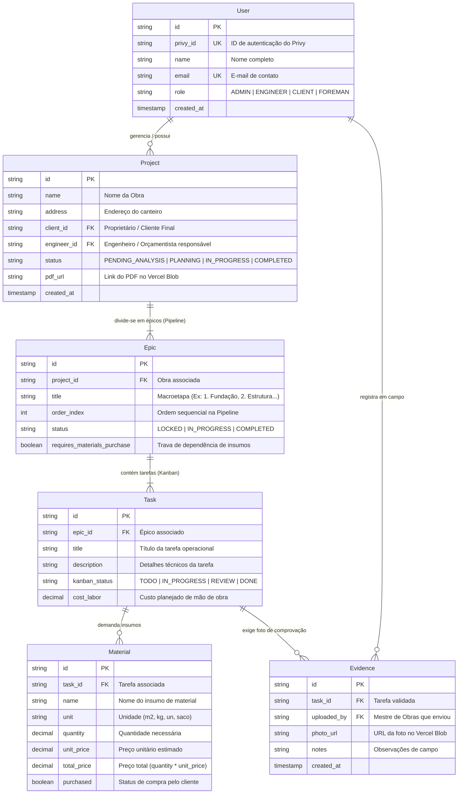

# Modelo Entidade-Relacionamento (MER) do ObraFlow e Regras de Negócio

Abaixo está a versão atualizada e consolidada do Modelo Entidade-Relacionamento (MER) do ObraFlow, com o diagrama limpo, o dicionário de dados atualizado e uma seção exclusiva detalhando os relatórios e as regras matemáticas de cálculo de avanço físico e financeiro.

## 1. Diagrama Entidade-Relacionamento (MER)



## 2. Dicionário de Dados Resumido

* **users**: Armazena os perfis (ADMIN, ENGINEER, CLIENT, FOREMAN) autenticados via Privy.
* **projects**: Centraliza a obra, vinculando o cliente, o engenheiro e o PDF base armazenado no Vercel Blob.
* **epics**: Representa as macroetapas sequenciais da pipeline superior (com controle de trava para compra de materiais).
* **tasks**: As unidades de trabalho operacionais divididas nas colunas do Kanban (TODO, IN_PROGRESS, REVIEW, DONE), contendo o custo de mão de obra.
* **materials**: Insumos de materiais atrelados às tarefas, controlando o preço total e se já foram adquiridos (purchased).
* **evidences**: Fotos obrigatórias vinculadas às tarefas concluídas para garantir a veracidade do avanço físico.

## 3. Sessão Específica: Relatórios e Cálculos de Avanço (Físico vs. Financeiro)

Para que o ObraFlow entregue previsibilidade real e elimine o atrito entre cliente, engenheiro e construtor, o motor de relatórios do sistema calcula dinamicamente o Avanço Físico e o Avanço Financeiro com base no peso de cada tarefa dentro da Estrutura Analítica de Projeto (EAP).

### 3.1. O Conceito de Peso na EAP (Valor Agregado Simplificado)

Como tarefas possuem importâncias distintas (ex: Concretagem da Fundação custa e consome muito mais tempo do que a Instalação de uma Tomada), o sistema utiliza o Custo Total da Tarefa como peso relativo.

### 3.2. Cálculo do Avanço Físico (% Físico)

O avanço físico mede a execução real no canteiro, validada por evidências imutáveis.
* **Regra de Conclusão**: Uma tarefa só pontua 100% de avanço físico quando seu `kanban_status` é `DONE` e possui uma foto registrada na tabela `evidences`. Tarefas em andamento (TODO, IN_PROGRESS, REVIEW) pontuam proporcionalmente ou 0%.
* **Fórmula do Projeto**: `Avanço Físico = (Soma do custo das tarefas concluídas) / (Custo total do projeto)`
* **Visualização nos Relatórios**: Exibido em barras de progresso na Master Pipeline (por épico) e em um card principal de KPI no Dashboard do Cliente e Admin.

### 3.3. Cálculo do Avanço Financeiro (% Financeiro / Consumo de Orçamento)

O avanço financeiro mede o comprometimento do orçamento planejado em relação ao que foi gasto ou efetivamente comprado.
* **Fórmula do Projeto**: `Avanço Financeiro = (Soma do custo financeiro realizado) / (Custo total do projeto)`
* **Trava de Dependência**: Se um épico possui `requires_materials_purchase = true` e os materiais (`materials.purchased`) ainda não foram quitados pelo cliente, o avanço financeiro e a liberação operacional daquele bloco ficam travados.

### 3.4. O Painel de Saúde da Obra (Comparativo Físico vs. Financeiro)

Os relatórios gerenciais geram automaticamente um termômetro de desvio para alertar o Administrador e o Engenheiro sobre gargalos:

```text
========================================================
📊 RELATÓRIO DE SAÚDE DA OBRA: Residencial Alpha
========================================================
[==========================                  ] 62% Avanço Físico (Executado no canteiro)
[================================            ] 75% Avanço Financeiro (Gasto / Comprado)
--------------------------------------------------------
⚠️ ALERTA DE DESVIO: O avanço financeiro está 13% acima do avanço físico.
```

* **Cenário Ideal (Físico > Financeiro)**: A obra está altamente eficiente, produzindo mais do que consome de orçamento.
* **Cenário de Alerta (Físico < Financeiro)**: A obra está consumindo recursos mais rápido do que a execução física no canteiro (indica compra antecipada excessiva de materiais, desperdício ou baixa produtividade da mão de obra).

### 3.5. Tipos de Relatórios Disponibilizados no ObraFlow

* **Relatório Executivo (Para o Cliente Final / Proprietário)**:
  * Focado em simplificar a complexidade: Mostra o % de avanço físico geral, a linha do tempo dos épicos e a galeria de fotos comprovadas (evidences), reduzindo a ansiedade e eliminando ligações de cobrança diária.
* **Relatório Operacional (Para o Engenheiro / Mestre de Obras)**:
  * Focado no fluxo de tarefas diárias (Kanban) e na listagem de insumos de materiais necessários para destravar os próximos épicos da pipeline.
* **Relatório Consolidado Corporativo (Para o Administrador da Construtora)**:
  * Visão macro cruzando todas as obras ativas da construtora, exibindo margens operacionais, desvios orçamentários em tempo real e o status global dos canteiros.
