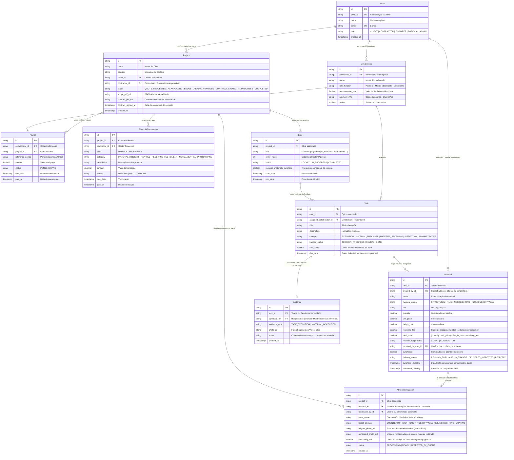
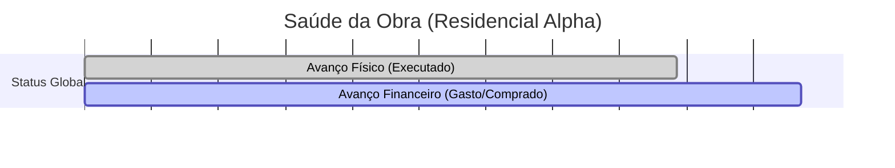
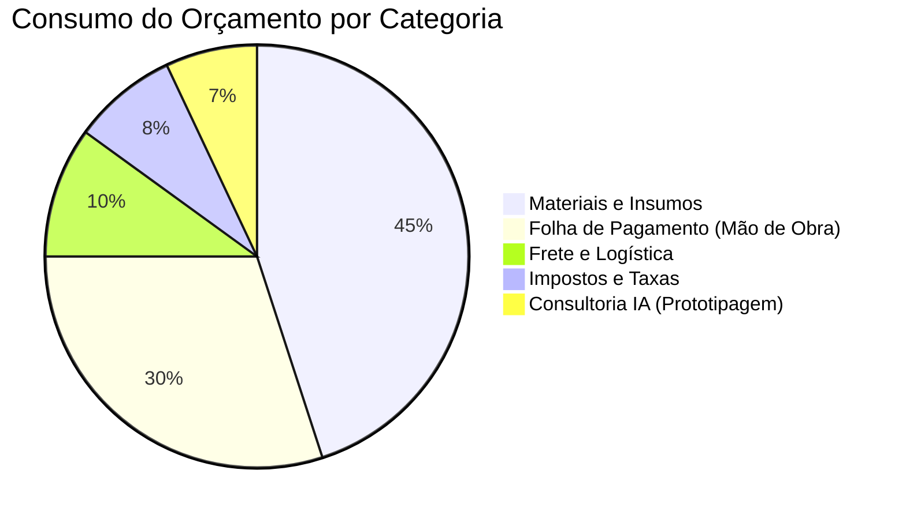

# Arquitetura de Dados e MER Atualizado do ObraFlow

A nova arquitetura de dados do ObraFlow expande o motor central de Épicos e Kanban para englobar o ciclo comercial do cliente (orçamento e assinatura de contrato), o ERP financeiro do empreiteiro (colaboradores, folha de pagamento, contas a pagar/receber), a logística de frete e recebimento em obra, e o módulo de prototipagem de ambientes por Inteligência Artificial.

## 1. Diagrama Entidade-Relacionamento (MER Atualizado)

## 2. Dicionário de Dados Detalhado (Tabelas)

Abaixo explicamos o papel de cada entidade (tabela) que compõe a arquitetura do ObraFlow:

* **User**: Tabela central de usuários. Armazena a identidade (nome, e-mail) e o papel (`role`) no sistema (Cliente, Empreiteiro, Engenheiro, etc.). A autenticação real é delegada ao provedor externo (Privy), por isso o campo `privy_id`.
* **Project**: Representa a obra em si. É o núcleo que liga o proprietário (`client_id`) à construtora (`contractor_id`). Controla a jornada desde o orçamento (`QUOTE_REQUESTED`) até a execução (`IN_PROGRESS`), armazenando links vitais como o PDF do projeto e do contrato assinado.
* **Collaborator**: Representa a força de trabalho operacional do empreiteiro (pedreiros, mestres de obras, eletricistas). Armazena seus dados básicos, taxa de remuneração (diária/salário) e chave de pagamento.
* **Payroll**: Tabela de folha de pagamento que cruza o colaborador com a obra em que ele trabalhou num período específico, gerando a obrigação de pagamento (status pendente ou pago).
* **FinancialTransaction**: O coração financeiro (ERP) do projeto. Registra todas as movimentações de caixa (entradas do cliente e saídas para fornecedores, folha e impostos). Categoriza cada despesa para permitir o cálculo da margem e do avanço financeiro real.
* **Epic**: A macro-divisão estrutural da obra (ex: Fundação, Alvenaria, Acabamento). Serve para ordenar a linha do tempo (Master Pipeline) e travar/destravar o progresso caso existam dependências financeiras ou de compra pendentes.
* **Task**: As tarefas atômicas da obra que compõem um Épico. Elas vivem no Kanban e possuem categorias específicas (execução civil, compra de material, recebimento, etc.). É no nível da tarefa que se registra o custo da mão de obra (`cost_labor`).
* **Material**: Insumos necessários para completar uma tarefa. Esta tabela controla o que, quanto, e por quanto deve ser comprado. Também incorpora toda a inteligência logística: quem recebe no canteiro, frete, e taxa extra caso o empreiteiro assuma o tempo de recebimento da carga.
* **Evidence**: Registro de comprovação em campo (foto obrigatória). Garante transparência total: uma tarefa só é `DONE` fisicamente quando uma evidência fotográfica é anexada.
* **AIRoomSimulation**: O módulo de Inovação em Prototipagem. Registra simulações onde a IA mescla uma foto real do canteiro (em reboco, por exemplo) com materiais virtuais, facilitando a decisão de compra e gerando receita de consultoria (`consulting_fee`).

## 3. Detalhamento das Novas Regras de Negócio no Banco de Dados

| Módulo | Entidades Envolvidas | Como Funciona na Prática |
|---|---|---|
| Jornada Comercial do Cliente | projects | O status evolui de QUOTE_REQUESTED (pedido de orçamento) -> AI_ANALYZING (leitura do PDF via IA) -> BUDGET_READY -> APPROVED (aprovação do orçamento) -> CONTRACT_SIGNED (assinatura registrada em contract_pdf_url e contract_signed_at) -> IN_PROGRESS. |
| Kanban Polimórfico (Visões Personalizadas) | tasks (category) | Cliente e Empreiteiro enxergam o mesmo quadro Kanban (TODO, IN_PROGRESS, REVIEW, DONE), mas o atributo tasks.category permite criar filtros e visões dinâmicas por assunto: Execução Civil, Compras de Material, Recebimento e Conferência, Vistorias e Administrativo. |
| Logística, Frete e Recebimento de Material | materials, tasks, evidences | Tanto CLIENT quanto CONTRACTOR podem cadastrar materiais (created_by_id) e informar o frete (freight_cost). Na entrega, o campo receiver_responsible define quem receberá no canteiro: se for CLIENT, o custo adicional é R$ 0,00 (mas o cliente assume o compromisso de estar na obra); se for CONTRACTOR, o sistema adiciona a taxa receiving_fee ao custo da tarefa para cobrir o deslocamento/tempo do colaborador que fará a checagem com foto obrigatória (evidence_type = MATERIAL_INSPECTION). |
| ERP do Empreiteiro (RH e Financeiro) | collaborators, payrolls, financial_transactions | O empreiteiro cadastra sua equipe em collaborators, gera a folha de pagamento por obra em payrolls e controla todo o fluxo de caixa (parcelas a receber do cliente, pagamento de fornecedores, fretes e diárias) em financial_transactions. |
| Prototipagem de Ambientes via IA | ai_room_simulations, materials | Conectado ao cronograma de compras: o usuário tira uma foto real do cômodo ainda em osso ou reboco (original_photo_url), escolhe os materiais de acabamento (pia, revestimento, forro de gesso, luminárias) e a IA gera uma visualização realista do item instalado (generated_photo_url), destravando a decisão de compra e gerando receita de consultoria (consulting_fee). |

## 3. Relatórios e Cálculos de Avanço (Físico, Financeiro e Compras)

### 3.1. Cálculo de Peso da EAP (Orçamento Base Expandido)
Com a inclusão do frete, da taxa de recebimento em obra e da consultoria de IA, o custo planejado de cada tarefa (C_tarefa) passa a integrar todas as variáveis logísticas e operacionais:
`Custo Total da Tarefa = Custo Mão de Obra + (Soma dos Insumos) + Custo Fretes + Custo Recebimentos + Consultoria IA`

### 3.2. Cálculo do Avanço Físico (% Físico)
O avanço físico mede exclusivamente o trabalho e a logística concluídos e comprovados visualmente no canteiro.
* **Regra de Validação**: Uma tarefa de execução ou de recebimento/conferência de material só atinge 100% quando seu status muda para DONE mediante o upload de uma foto em evidences.
* **Fórmula Matemática**:
`Avanço Físico (%) = (Soma do C_tarefa das Tarefas DONE e Comprovadas) / (Custo Total do Projeto)`

### 3.3. Cálculo do Avanço Financeiro (% Financeiro e Fluxo de Caixa)
O avanço financeiro reflete o consumo real do orçamento somando insumos adquiridos, fretes contratados, taxas de recebimento, folha de pagamento executada e serviços de prototipagem IA.
* **Visão do Orçamento da Obra (Cliente e Empreiteiro)**:
`Avanço Financeiro (%) = (Soma dos Custos Realizados) / (Custo Total Orçado do Projeto)`
* **Visão de Margem e Fluxo de Caixa (Exclusiva do Empreiteiro)**:
`Margem do Projeto = (Receita Total Recebida do Cliente) - (Soma dos Custos de Folha + Repasses a Fornecedores + Impostos)`

### 3.4. Especificação dos Relatórios Inteligentes do Sistema

1. **Relatório de Gestão e Cronograma de Compras (Supply Chain + Consultoria IA)**
* **Lógica de Geração**: Varre todas as tasks filtrando pela categoria MATERIAL_PURCHASE e cruza a data de início dos epics (start_date) com o prazo de entrega do frete (estimated_delivery), ordenando pela data limite de compra (purchase_deadline).
* **Prevenção de Gargalos**: Destaca em vermelho os materiais com purchased = false cujo purchase_deadline vence nos próximos 7 dias, evitando que o Épico fique bloqueado (status = LOCKED).
* **Gatilho de Venda (Consultoria / Prototipagem IA)**: Para todos os itens dos grupos FINISHINGS, LIGHTING e DRYWALL que ainda não foram comprados, o relatório exibe o botão "Simular no Cômodo com IA", abrindo o fluxo da tabela ai_room_simulations para o cliente visualizar pias, revestimentos, gesso e luminárias aplicados na foto real da sua obra antes de bater o martelo na compra.

2. **Painel de Visões Personalizadas do Kanban (Filtros por Categoria)**
* **Visão "Logística e Recebimento em Canteiro"**: Filtra tasks.category = 'MATERIAL_RECEIVING'. Exibe cartões contendo a data prevista do frete (estimated_delivery), quem deve estar na obra para assinar e conferir (receiver_responsible = CLIENT ou CONTRACTOR) e o botão para anexar a foto do material entregue sem avarias.
* **Visão "Execução de Campo"**: Filtra tasks.category = 'EXECUTION', focada no Mestre de Obras e nos colaboradores alocados.

3. **Relatório Comparativo de Saúde da Obra (Termômetro Físico vs. Financeiro)**
* Compara lado a lado o % de Avanço Físico e o % de Avanço Financeiro geral e por Épico.
* Aponta desvios automaticamente: se o cliente antecipou compras de revestimentos e fretes mas a alvenaria ainda não terminou, o relatório explica de forma transparente que a diferença entre o Financeiro e o Físico decorre do estoque de materiais já adquiridos no canteiro, mantendo a confiança entre cliente e empreiteiro.

### 3.5. Simulação Visual de Relatórios (Gráficos)

Abaixo simulamos como os dados estruturados no MER se traduzem em painéis visuais dentro da plataforma ObraFlow.

**Avanço Físico x Avanço Financeiro (Termômetro de Saúde)**

*Interpretação:* O gráfico alerta visualmente que a obra já comprometeu 75% do orçamento financeiro, mas executou apenas 62% do cronograma físico no canteiro.

**Distribuição do Orçamento (Fluxo de Caixa / FinancialTransaction)**

