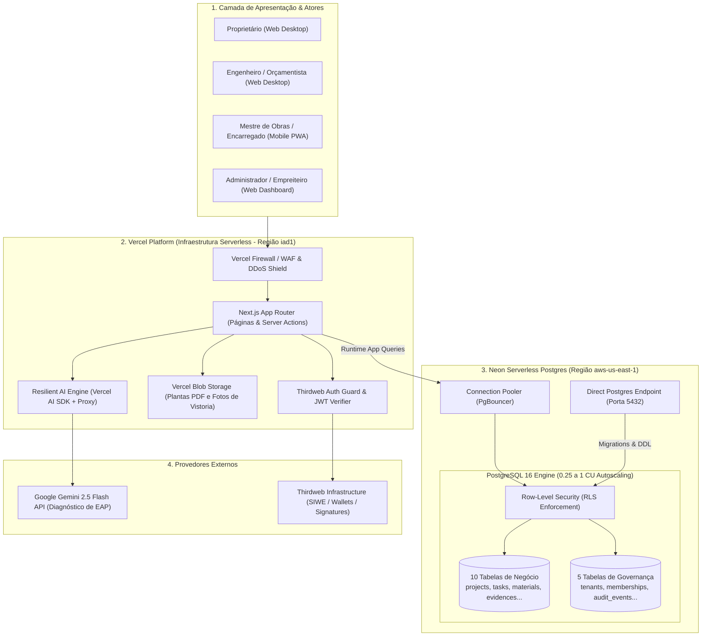
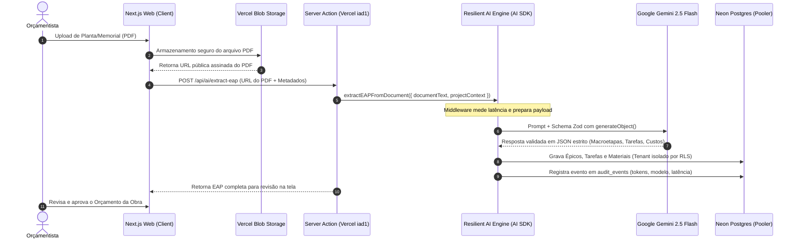
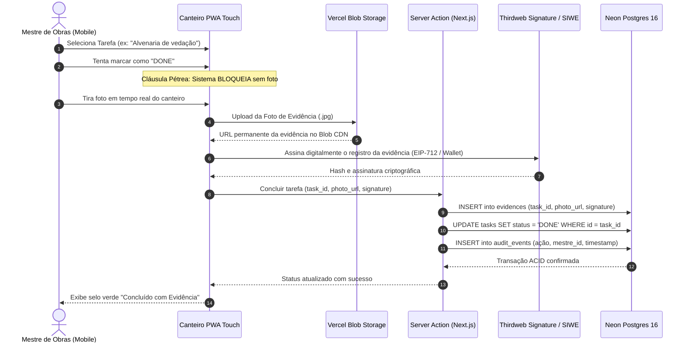
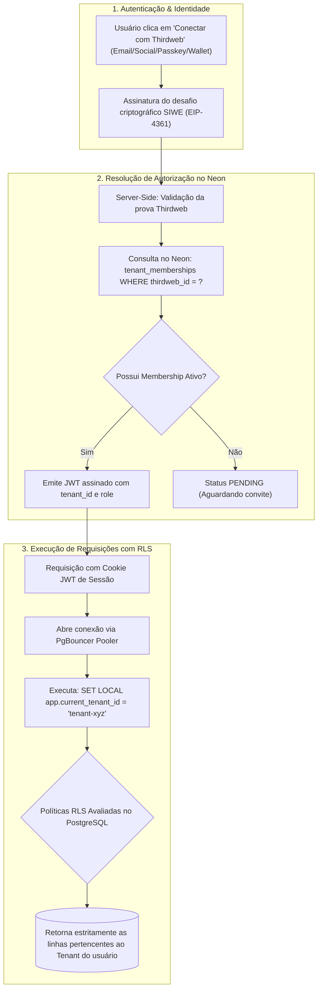
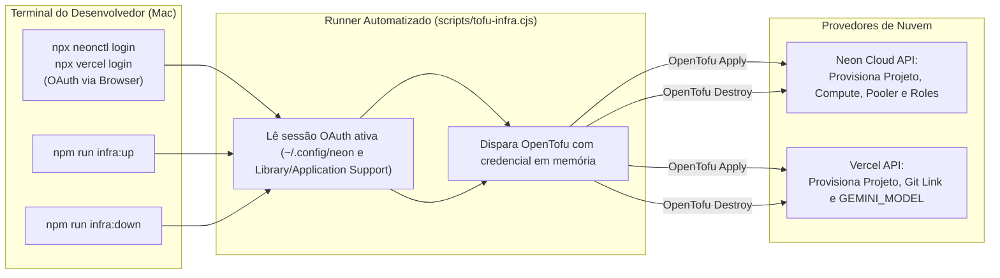

# Diagramas de Infraestrutura por Casos de Uso e Jornadas — ObraFlow

Este documento apresenta a infraestrutura do ObraFlow mapeada ponta a ponta, dividida pela visão geral da arquitetura e detalhada em cada uma das suas **4 jornadas operacionais** principais (Orçamento com IA, Canteiro Mobile, Autenticação/Auditoria e Governança CI/CD).

---

## 1. Topologia Geral da Infraestrutura

Visão consolidada de todos os serviços orquestrados via **OpenTofu**, **Vercel**, **Neon** e APIs externas:

---

## 2. Jornada 1: Novo Orçamento & Diagnóstico Inteligente de EAP com IA

**Ator:** Engenheiro / Orçamentista  
**Objetivo:** Fazer upload do PDF da planta/memorial, processar com Google Gemini e gerar a EAP estruturada de macroetapas, custos e insumos.

---

## 3. Jornada 2: Canteiro Mobile Touch com Evidência Fotográfica Obrigatória

**Ator:** Mestre de Obras / Encarregado em campo  
**Objetivo:** Concluir uma etapa física de obra no canteiro mediante envio obrigatório de evidência visual (foto) auditada.

---

## 4. Jornada 3: Autenticação Multi-Tenant, Resolução de Sessão e RLS

**Atores:** Todos os perfis (Proprietário, Construtor, Engenheiro, Designer)  
**Objetivo:** Login seguro sem senhas fracas, mapeamento de tenants no Neon e isolamento automático de dados via Row-Level Security.

---

## 5. Jornada 4: Infraestrutura como Código & Ciclo de Vida CI/CD (Zero Tokens)

**Ator:** Desenvolvedor / DevOps  
**Objetivo:** Subir, validar e destruir a infraestrutura sob demanda sem expor nem criar tokens estáticos manuais.

---

## 6. Matriz de Auditoria de Componentes

| Componente | Planejado em | Onde está no Código | Status Atual | Detalhes / Observações |
| :--- | :--- | :--- | :--- | :--- |
| **Cluster Neon (PostgreSQL 16)** | ADR-0004 | `infra/terraform/neon/main.tf` | 🟢 **Coberto (IaC)** | Provisiona projeto, Postgres 16, autoscaling compute (0.25-1 CU) e region matching (`aws-us-east-1`). |
| **Connection Pooler (PgBouncer)** | ADR-0004 | `infra/terraform/neon/outputs.tf` | 🟢 **Coberto (IaC)** | Gerado nativamente pelo Neon no endpoint pooled (`database_host_pooler`). |
| **PITR History Retention** | ADR-0004 | `infra/terraform/neon/variables.tf` | 🟢 **Coberto (IaC)** | Suporta 6h (Free) e escalável para 86400s (24h+ em Pro). |
| **Projeto Vercel (Next.js)** | ADR-0004 | `infra/terraform/vercel/main.tf` | 🟢 **Coberto (IaC)** | Configura projeto, Node 22, Git integration (`govinda777/ObraFlow`), root dir e região (`iad1`). |
| **Motor de IA Resiliente (Gemini)** | ADR-0006 | `infra/terraform/vercel/main.tf` & `src/lib/ai/` | 🟢 **Coberto (IaC + App)** | Injeta `GEMINI_MODEL = "gemini-2.5-flash"` e usa Vercel AI SDK com Zod schemas. |
| **Regras de Build & Dependências** | ADR-0004 | `infra/terraform/vercel/main.tf` | 🟢 **Coberto (IaC)** | `install_command = "npm ci --legacy-peer-deps"` e `build_command = "npm run build:web"`. |
| **Vercel Blob Storage** | ADR-0004 | Vercel Storage Console / API | 🟡 **Provisionamento Externo** | Habilitado via Dashboard Vercel (`Storage > Create Blob Store`). Injeta `BLOB_READ_WRITE_TOKEN`. |
| **Roles PostgreSQL Menor Privilégio** | ADR-0004 / ADR-0005 | `infra/terraform/neon/main.tf` | 🟢 **Coberto (IaC)** | Declara `obraflow_runtime` (apenas DML com RLS) e `obraflow_migrator` (DDL restrito, sem bypass de RLS). |
| **Schema e 10 Tabelas MER** | ADR-0004 | `scripts/db/migrations/0001_*.sql` | 🟢 **Coberto (Migrations)** | `users`, `projects`, `epics`, `collaborators`, `tasks`, `materials`, `evidences`, `financial_transactions`, `payrolls`, `ai_room_simulations`. |
| **Multi-tenancy & Auditoria (5 Tabelas)** | ADR-0005 | `scripts/db/migrations/0002_*.sql` | 🟢 **Coberto (Migrations)** | `tenants`, `tenant_memberships`, `role_permissions`, `project_memberships`, `audit_events`. |
| **Políticas de Row-Level Security (RLS)** | ADR-0005 | `scripts/db/migrations/0002_*.sql` | 🟢 **Coberto (Migrations)** | RLS ativada com políticas de tenant context em todas as tabelas sensíveis. |
