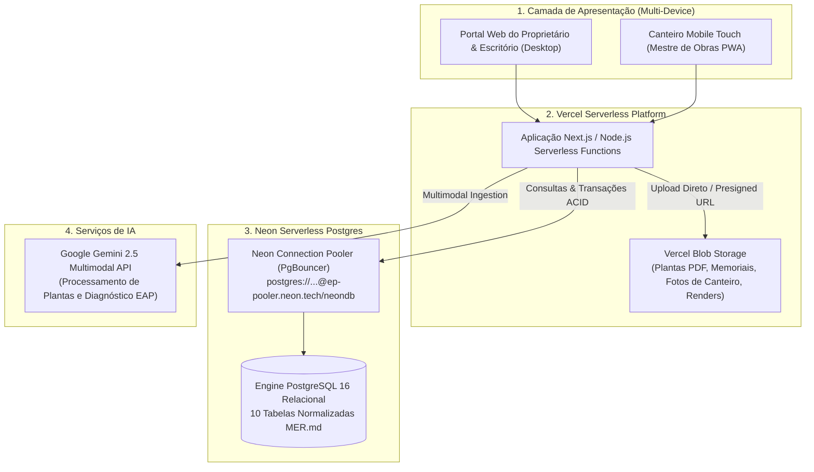

# ADR-0004: Migração da Camada de Persistência para Neon DB (PostgreSQL Serverless) e Arquitetura de Deploy na Vercel

| Metadado | Valor |
| :--- | :--- |
| **Status** | 🟢 `Accepted` |
| **Data** | 2026-11-07 |
| **Autores** | Equipe ObraFlow |
| **Contexto** | Evolução da fase de protótipo (`mock_data/*.json` + Evidence) para produção SaaS multi-tenant escalável |
| **Decisões Relacionadas** | [MER.md](../../MER.md), [ACTORS.md](../../ACTORS.md), [RFC-0001](./0001-prototipagem-dados-e-relatorios.md), [RFC-0002](./0002-adr-jornada-orcamento-contrato-ia.md), [ADR-0003](./0003-adr-processamento-ia-eap-mockdata.md) |

---

## 1. Contexto e Problema

O **ObraFlow** operou com sucesso como protótipo interativo local utilizando persistência orientada a arquivos JSON em `mock_data/` e consultas analíticas DuckDB com Evidence.dev.

Entretanto, para avançar rumo ao lançamento SaaS comercial com múltiplos clientes, engenheiros, mestres de obras e empreiteiros operando em tempo real no canteiro, os arquivos JSON e o filesystem efêmero local apresentam gargalos estruturais:
1. **Concorrência e Locks:** Gravações concorrentes de múltiplos canteiros e vistorias sobre arquivos JSON sofrem de condições de corrida (*race conditions*).
2. **Infraestrutura Serverless:** Na Vercel, o sistema de arquivos local (`fs`) é somente leitura em produção (exceto diretório efêmero `/tmp` não compartilhado entre invocações).
3. **Integridade Referencial e Cláusula Pétrea:** Regras de negócio rígidas (como impedir tarefas `DONE` sem evidência fotográfica vinculada ou despesas sem lançamento de caixa) exigem constraints relacionais nativas (`FOREIGN KEY ... ON DELETE CASCADE`, `CHECK constraints` e transações ACID).

---

## 2. Decisão Arquitetural

Decidimos migrar a camada transacional do ObraFlow para o **Neon DB (PostgreSQL Serverless)** e implantar a aplicação na plataforma **Vercel**, adotando a seguinte divisão de responsabilidades:



### 2.1. Banco de Dados: Neon DB (PostgreSQL Serverless)
- **Engine Relacional:** PostgreSQL 16 gerenciado nativamente.
- **Connection Pooling:** Utilização mandatória de conexões pooled (`?sslmode=require&pgbouncer=true`) nas Serverless Functions para evitar esgotamento de conexões abertas por concorrência.
- **Isolamento de Branches:** Cada branch do Git (ex: `preview`, `staging`, `main`) pode espelhar instantaneamente uma branch do banco no Neon (*Instant Point-in-time Branching*), permitindo testar seeds e migrações com zero risco para a produção.
- **Drivers Suportados:**
  - `@neondatabase/serverless` para requisições Edge/HTTP ultrarrápidas;
  - `pg` (node-postgres) para conexões persistentes e scripts de migração/seed.
- **Configuração como código:** Projeto, branch raiz, compute, database e roles PostgreSQL serão declarados em OpenTofu; migrations versionadas declararão schema, grants e RLS. Configuração manual no Console não será fonte de verdade.
- **Identidades PostgreSQL separadas:** A aplicação usará uma role de runtime sem `SUPERUSER`, `CREATEDB`, `CREATEROLE`, `REPLICATION` ou `BYPASSRLS`, com grants mínimos e RLS forçada. Migrations usarão role própria (`obraflow_migrator`), sem `SUPERUSER`, `CREATEDB`, `CREATEROLE` ou `BYPASSRLS`, com privilégios de DDL limitados ao database/schema, conexão direta e nunca o pooler. O executor de migrations verificará a identidade da conexão. A URL pooled runtime será injetada como secret no ambiente Vercel; a URL de migration ficará somente no executor/CI.
- **Criação segura de roles:** Roles criadas pela API/Console Neon herdam `neon_superuser`; por isso, a role de aplicação será criada via provider PostgreSQL/SQL com privilégios explicitamente limitados, não via `neon_role`. Consulte [a documentação oficial de roles Neon](https://neon.com/docs/manage/roles).
- **Secrets e state:** Senhas serão injetadas por secret manager, não gravadas em arquivos `.tfvars`, outputs ou repositório. Senhas das roles runtime e migration serão write-only/efêmeras no OpenTofu. Variáveis Vercel server-only usarão argumentos write-only e valores efêmeros, separadas por target e branch; variáveis `NEXT_PUBLIC_*` serão tratadas como públicas. State remoto com criptografia, locking e acesso restrito é requisito para ambientes compartilhados. Credenciais de migration e seed não serão entregues à aplicação Vercel.

### 2.2. Armazenamento de Arquivos: Vercel Blob
- Plantas arquitetônicas (`.pdf`), planilhas orçamentárias (`.csv`), memoriais (`.md`), fotos de vistoria (`.jpg`, `.png`) e simulações SVG não residirão no banco de dados nem no disco efêmero, sendo servidas via **Vercel Blob CDN** com URLs assinadas e permanentes.

### 2.3. Segurança, Resiliência e Governança das Chamadas de IA

As chamadas aos provedores de IA serão executadas exclusivamente no backend da Vercel. O navegador não terá acesso às chaves do Google Gemini, nem fará chamadas diretas ao provedor. Chaves de API serão armazenadas somente como variáveis de ambiente protegidas da Vercel.

O fluxo de processamento será:

```text
Cliente autenticado
    -> Vercel Firewall / WAF
    -> Middleware: autenticação, autorização e rate limit
    -> API Route / Server Action na Vercel
    -> Fila ou workflow assíncrono
    -> Google Gemini
    -> Neon: status, resultado, tentativas e auditoria
```

#### Proteção contra DDoS e abuso

- A mitigação automática de DDoS da Vercel protege as camadas L3, L4 e L7 da aplicação.
- O Vercel Firewall/WAF será configurado com regras para bloquear, desafiar ou limitar tráfego anômalo, incluindo rotas de login, upload e criação de jobs de IA.
- A proteção de borda contra DDoS não será considerada suficiente para impedir abuso por usuários autenticados. As rotas de IA também terão controles de aplicação.
- O rate limiting será distribuído, por IP, usuário e organização/tenant, usando armazenamento externo compatível com serverless, como Redis/Upstash. Não será utilizado estado em memória da Function como mecanismo de segurança.
- Cada organização terá quota diária/mensal de jobs, tokens e custo estimado de IA. A quota será validada antes do envio ao provedor.
- O sistema limitará tamanho e tipo dos arquivos, quantidade de anexos, tokens de entrada/saída e duração máxima das chamadas.
- Cada solicitação aceitará uma chave de idempotência para impedir cobranças e jobs duplicados por reenvio ou retry do cliente.
- Serão registrados tenant, usuário, projeto, modelo, tokens, duração, status, custo estimado, IP anonimizado e motivo de falha, sem registrar chaves secretas ou conteúdo sensível desnecessário.

#### Processamento assíncrono e resiliência do provedor

Processamentos potencialmente demorados, como leitura de PDF, extração de quantitativos e geração da EAP, serão tratados como jobs assíncronos:

1. `POST /api/ai/jobs` valida a requisição, aplica quota e cria o job com status `QUEUED`.
2. O worker ou workflow executa o processamento e atualiza o Neon com `PROCESSING`, `COMPLETED` ou `FAILED`.
3. O cliente consulta o status ou recebe uma atualização por mecanismo apropriado de polling/revalidação.
4. Retries terão limite, backoff exponencial e serão idempotentes.
5. Um circuit breaker interromperá temporariamente chamadas quando o provedor estiver indisponível ou exceder seus limites.
6. O fallback com dados pré-calibrados será usado somente quando explicitamente permitido pelo fluxo; ele não substituirá silenciosamente uma falha de segurança, quota ou autorização.

As Functions terão `maxDuration` configurado de acordo com o tipo de processamento, região próxima ao banco Neon e alertas de consumo. Escalabilidade automática da Vercel será tratada como capacidade de execução, não como substituto para rate limiting, quotas ou controle de custos.

Essa decisão substitui a abordagem de chamada direta ao Gemini pelo navegador descrita nos documentos de prototipagem. A chamada client-side poderá existir apenas em ambiente local/demonstração, com chave temporária e sem dados reais de produção.

### 2.4. Identidade, Autorização de Negócio e Integração Thirdweb

Esta ADR define a plataforma de deploy e infraestrutura; **não cria um modelo de autorização paralelo**. As regras de autenticação da aplicação, memberships, perfis, permissões, JWT e RLS são detalhadas pela [ADR-0005](./0005-adr-autorizacao-por-jwt-neon-e-auditoria-de-eventos.md). Como a ADR-0005 está `Proposed`, sua implementação em produção depende de aprovação. Uma vez aprovada, ela será a fonte de verdade para autorização e substituirá qualquer descrição divergente desta seção.

O Thirdweb comprova a identidade/autenticidade da wallet e fornece capacidades Web3. Não é a fonte de autorização para dados e perfis de negócio do ObraFlow. Os papéis de equipe Thirdweb (`Member`, `Owner`) governam acesso à equipe/projeto Thirdweb e não equivalem aos perfis do SaaS. [Thirdweb team members](https://portal.thirdweb.com/account/teams/manage-team-members), [Thirdweb permissions](https://portal.thirdweb.com/tokens/build/extensions/general/Permissions)

#### Fluxo de identidade e sessão

- O fluxo de wallet adotado é SIWE/EIP-4361. Acrescentar outro método de login requer decisão explícita e atualização da ADR de autenticação.
- O backend valida o desafio/assinatura Thirdweb, localiza a identidade (`thirdweb_id`) e consulta no Neon o tenant e o membership ativo.
- Após essa resolução, o backend emite a **sessão da aplicação** de curta duração usando Thirdweb Auth server-side. O token ou estado enviado pelo client não é fonte de claims de autorização; `tenant_id`, membership, perfil e permissões são derivados do Neon.
- O perfil pertence ao membership do usuário em um tenant, não à identidade global. O mesmo usuário pode ter perfis diferentes em tenants diferentes; o acesso a projetos também exige vínculo autorizado ao projeto.
- A autorização é avaliada no backend e reforçada por RLS no Neon. Claims de sessão são um snapshot limitado; operações críticas verificam o membership atual. Selecionar um perfil no cadastro não concede acesso a tenants existentes.

#### Roles e operações on-chain

Não haverá mapeamento global ou automático de `CLIENT`, `CONTRACTOR`, `ENGINEER`, `FOREMAN`, `DESIGNER` ou `PLATFORM_ADMIN` para roles on-chain. Esses perfis e permissões de negócio ficam no Neon. Assinaturas EIP-712 e ancoragem de hashes são mecanismos de prova/integridade, não uma fonte alternativa de RBAC.

Se uma feature futura exigir que um contrato imponha autorização on-chain, ela deverá ter uma ADR própria definindo funções/roles específicas do contrato, chain, escopo, operador, concessão/revogação e reconciliação. Essa permissão será um requisito adicional apenas para a operação on-chain em questão: não concederá acesso a dados privados do ObraFlow e não será sincronizada automaticamente a partir do perfil de negócio. Quando aplicável, a operação exige tanto a autorização do ObraFlow/Neon quanto a regra específica do contrato. Nenhum perfil operacional receberá `DEFAULT_ADMIN_ROLE` ou poderes irrestritos de smart account.

#### Configuração e segurança Thirdweb

- `THIRDWEB_CLIENT_ID` poderá ser usado no client somente com domínios/origens permitidos por ambiente.
- `THIRDWEB_SECRET_KEY`, chave de assinatura de sessão, chaves de deployer/relayer e segredos de webhook ficam exclusivamente server-side, como secrets da Vercel/secret manager.
- Separar configuração e credenciais de preview/testnet das de produção/mainnet; não inferir IDs, contratos ou permissões a partir da URL. [Thirdweb API keys](https://portal.thirdweb.com/account/api-keys/create)
- Associar uma wallet ao usuário somente após prova de posse por assinatura/challenge; endereço informado livremente não prova identidade.
- Webhooks Thirdweb, quando usados, validam assinatura, timestamp, nonce/replay protection e idempotência antes de alterar o Neon.
- Inspecionar a equipe real `govinda-systems` por acesso autenticado e registrar valores verificados por ambiente. Ser membro/`Owner` da equipe Thirdweb não concede perfil de negócio no ObraFlow.

### 2.5. Sistema Declarativo de Seeds
Para garantir governança entre ambientes locais, testes de CI e nuvem, a infraestrutura adota 2 modos de inicialização:
1. **Seed Base (`npm run db:seed:clean`):** Cria a estrutura relacional e provisiona apenas os atores mestres do sistema (os 5 perfis de acesso: `CLIENT`, `CONTRACTOR`, `ENGINEER`, `FOREMAN`, `DESIGNER`).
2. **Seed de Demonstração (`npm run db:seed`):** Popula o banco com o portfólio completo de alta fidelidade:
   - 3 obras ativas (`Residencial Alpha`, `Reforma Loft Jardins` e a nova `Cobertura Duplex Pinheiros`);
   - 14 macroetapas (Épicos);
   - 31 tarefas com custos de mão de obra;
   - 24 materiais vinculados a fornecedores e prazos;
   - Evidências fotográficas auditadas de vistorias;
   - Transações de caixa e folhas de pagamento PIX quitadas e pendentes;
   - Simulações de ambientes Antes x Depois do Estúdio IA.

---

## 3. Consequências e Benefícios

### Positivas
- **Alta Escalabilidade Serverless:** Capacidade de escalar automaticamente de zero a centenas de canteiros simultâneos sem provisionamento de servidores dedicados.
- **Respeito Estrito ao MER:** Elimina a divergência de tipagem e integridade entre JSONs de demonstração e o banco de produção.
- **Branching no Neon:** Testes de integração e suítes BDD podem rodar contra branches efêmeras do Neon sem sujar os dados de homologação.
- **Velocidade de Deploy:** Deploy contínuo na Vercel conectado diretamente ao repositório GitHub com pré-visualizações completas em cada pull request.

### Mitigações e Cuidados
- **Modo Offline / Local:** O ambiente local preserva compatibilidade retroativa com `mock_data/*.json` para desenvolvedores que estiverem sem acesso à internet ou sem credencial de banco configurada.
- **Latência de Conexão:** Uso obrigatório do endpoint com Connection Pooling para evitar a sobrecarga de handshake SSL a cada invocação de função serverless.
