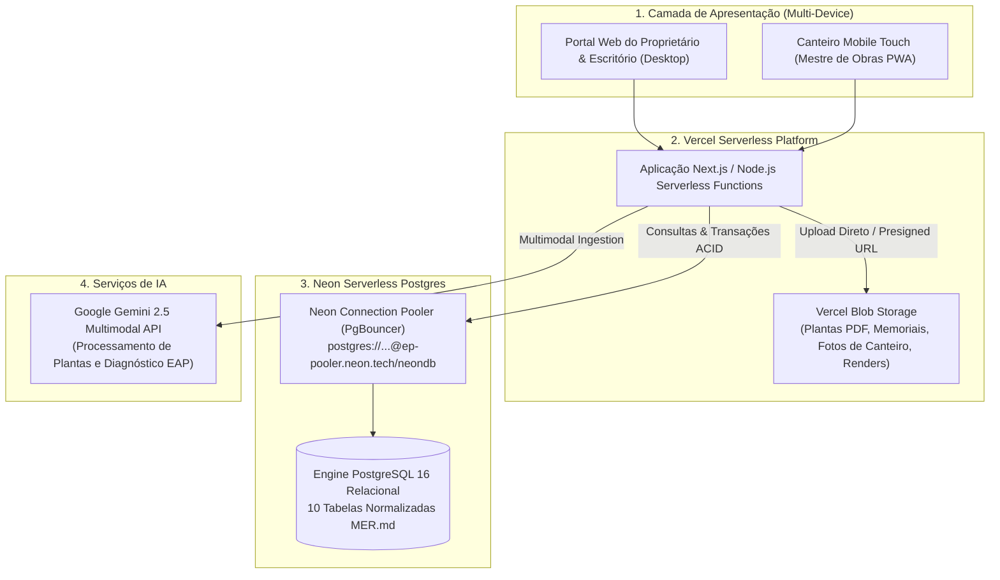

# ADR-0004: Migração da Camada de Persistência para Neon DB (PostgreSQL Serverless) e Arquitetura de Deploy na Vercel

| Metadado | Valor |
| :--- | :--- |
| **Status** | 🟢 `Accepted` |
| **Data** | 2026-11-07 |
| **Autores** | Equipe ObraFlow |
| **Contexto** | Evolução da fase de protótipo (`mock_data/*.json` + Evidence) para produção SaaS multi-tenant escalável |
| **Decisões Relacionadas** | [MER.md](../../MER.md), [ACTORS.md](../../ACTORS.md), [RFC-0001](./0001-prototipagem-dados-e-relatorios.md), [RFC-0002](./0002-adr-jornada-orcamento-contrato-ia.md), [ADR-0003](./0003-adr-processamento-ia-eap-mockdata.md) |

---

## 1. Contexto e Problema

O **ObraFlow** operou com sucesso como protótipo interativo local utilizando persistência orientada a arquivos JSON em `mock_data/` e consultas analíticas DuckDB com Evidence.dev.

Entretanto, para avançar rumo ao lançamento SaaS comercial com múltiplos clientes, engenheiros, mestres de obras e empreiteiros operando em tempo real no canteiro, os arquivos JSON e o filesystem efêmero local apresentam gargalos estruturais:
1. **Concorrência e Locks:** Gravações concorrentes de múltiplos canteiros e vistorias sobre arquivos JSON sofrem de condições de corrida (*race conditions*).
2. **Infraestrutura Serverless:** Na Vercel, o sistema de arquivos local (`fs`) é somente leitura em produção (exceto diretório efêmero `/tmp` não compartilhado entre invocações).
3. **Integridade Referencial e Cláusula Pétrea:** Regras de negócio rígidas (como impedir tarefas `DONE` sem evidência fotográfica vinculada ou despesas sem lançamento de caixa) exigem constraints relacionais nativas (`FOREIGN KEY ... ON DELETE CASCADE`, `CHECK constraints` e transações ACID).

---

## 2. Decisão Arquitetural

Decidimos migrar a camada transacional do ObraFlow para o **Neon DB (PostgreSQL Serverless)** e implantar a aplicação na plataforma **Vercel**, adotando a seguinte divisão de responsabilidades:



### 2.1. Banco de Dados: Neon DB (PostgreSQL Serverless)
- **Engine Relacional:** PostgreSQL 16 gerenciado nativamente.
- **Connection Pooling:** Utilização mandatória de conexões pooled (`?sslmode=require&pgbouncer=true`) nas Serverless Functions para evitar esgotamento de conexões abertas por concorrência.
- **Isolamento de Branches:** Cada branch do Git (ex: `preview`, `staging`, `main`) pode espelhar instantaneamente uma branch do banco no Neon (*Instant Point-in-time Branching*), permitindo testar seeds e migrações com zero risco para a produção.
- **Drivers Suportados:**
  - `@neondatabase/serverless` para requisições Edge/HTTP ultrarrápidas;
  - `pg` (node-postgres) para conexões persistentes e scripts de migração/seed.

### 2.2. Armazenamento de Arquivos: Vercel Blob
- Plantas arquitetônicas (`.pdf`), planilhas orçamentárias (`.csv`), memoriais (`.md`), fotos de vistoria (`.jpg`, `.png`) e simulações SVG não residirão no banco de dados nem no disco efêmero, sendo servidas via **Vercel Blob CDN** com URLs assinadas e permanentes.

### 2.3. Segurança, Resiliência e Governança das Chamadas de IA

As chamadas aos provedores de IA serão executadas exclusivamente no backend da Vercel. O navegador não terá acesso às chaves do Google Gemini, nem fará chamadas diretas ao provedor. Chaves de API serão armazenadas somente como variáveis de ambiente protegidas da Vercel.

O fluxo de processamento será:

```text
Cliente autenticado
    -> Vercel Firewall / WAF
    -> Middleware: autenticação, autorização e rate limit
    -> API Route / Server Action na Vercel
    -> Fila ou workflow assíncrono
    -> Google Gemini
    -> Neon: status, resultado, tentativas e auditoria
```

#### Proteção contra DDoS e abuso

- A mitigação automática de DDoS da Vercel protege as camadas L3, L4 e L7 da aplicação.
- O Vercel Firewall/WAF será configurado com regras para bloquear, desafiar ou limitar tráfego anômalo, incluindo rotas de login, upload e criação de jobs de IA.
- A proteção de borda contra DDoS não será considerada suficiente para impedir abuso por usuários autenticados. As rotas de IA também terão controles de aplicação.
- O rate limiting será distribuído, por IP, usuário e organização/tenant, usando armazenamento externo compatível com serverless, como Redis/Upstash. Não será utilizado estado em memória da Function como mecanismo de segurança.
- Cada organização terá quota diária/mensal de jobs, tokens e custo estimado de IA. A quota será validada antes do envio ao provedor.
- O sistema limitará tamanho e tipo dos arquivos, quantidade de anexos, tokens de entrada/saída e duração máxima das chamadas.
- Cada solicitação aceitará uma chave de idempotência para impedir cobranças e jobs duplicados por reenvio ou retry do cliente.
- Serão registrados tenant, usuário, projeto, modelo, tokens, duração, status, custo estimado, IP anonimizado e motivo de falha, sem registrar chaves secretas ou conteúdo sensível desnecessário.

#### Processamento assíncrono e resiliência do provedor

Processamentos potencialmente demorados, como leitura de PDF, extração de quantitativos e geração da EAP, serão tratados como jobs assíncronos:

1. `POST /api/ai/jobs` valida a requisição, aplica quota e cria o job com status `QUEUED`.
2. O worker ou workflow executa o processamento e atualiza o Neon com `PROCESSING`, `COMPLETED` ou `FAILED`.
3. O cliente consulta o status ou recebe uma atualização por mecanismo apropriado de polling/revalidação.
4. Retries terão limite, backoff exponencial e serão idempotentes.
5. Um circuit breaker interromperá temporariamente chamadas quando o provedor estiver indisponível ou exceder seus limites.
6. O fallback com dados pré-calibrados será usado somente quando explicitamente permitido pelo fluxo; ele não substituirá silenciosamente uma falha de segurança, quota ou autorização.

As Functions terão `maxDuration` configurado de acordo com o tipo de processamento, região próxima ao banco Neon e alertas de consumo. Escalabilidade automática da Vercel será tratada como capacidade de execução, não como substituto para rate limiting, quotas ou controle de custos.

Essa decisão substitui a abordagem de chamada direta ao Gemini pelo navegador descrita nos documentos de prototipagem. A chamada client-side poderá existir apenas em ambiente local/demonstração, com chave temporária e sem dados reais de produção.

### 2.4. Autorização de Perfis, Thirdweb e Multi-tenancy

O **Thirdweb não será o sistema de autorização dos perfis de negócio do ObraFlow**. Ele será utilizado apenas para recursos Web3 explicitamente adotados, como wallets, contratos, Account Abstraction, RPC ou pagamentos. A autorização principal continuará no backend do ObraFlow, com identidade autenticada, organização/tenant, papel e permissões persistidos no Neon.

Essa separação evita que uma permissão de membro no painel do Thirdweb seja confundida com autorização para acessar obras, custos, documentos ou dados de outros tenants. No Thirdweb, os papéis de equipe controlam colaboração e administração da conta/projeto; no ObraFlow, os papéis controlam os dados e operações da aplicação. O Thirdweb documenta os papéis de equipe `Member` e `Owner`, enquanto permissões de contratos/wallets são uma camada distinta. [Thirdweb team members](https://portal.thirdweb.com/account/teams/manage-team-members), [Thirdweb permissions](https://portal.thirdweb.com/tokens/build/extensions/general/Permissions)

#### Matriz de autorização do ObraFlow

| Perfil ObraFlow | Escopo padrão | Permissões principais | Uso Thirdweb |
| :--- | :--- | :--- | :--- |
| `CLIENT` | Própria organização e projetos explicitamente vinculados | Consultar andamento, documentos autorizados, orçamento e evidências; aprovar etapas conforme workflow | Wallet opcional; nunca concede acesso administrativo ao projeto Thirdweb |
| `CONTRACTOR` | Organização e carteira de obras administradas | Gerenciar obras, orçamento, compras, folha, caixa, contratos e usuários autorizados | Operações Web3 somente quando habilitadas por uma permissão específica |
| `ENGINEER` | Projetos atribuídos | Criar/revisar orçamento, EAP, custos técnicos e diagnóstico de IA | Sem acesso a segredos ou administração Thirdweb |
| `FOREMAN` | Canteiros/projetos atribuídos | Atualizar tarefas e enviar evidências fotográficas | Wallet opcional; sem permissão de transferência ou administração |
| `DESIGNER` | Projetos atribuídos | Gerenciar acabamentos e simulações de ambientes | Wallet opcional; sem acesso financeiro por padrão |
| `PLATFORM_ADMIN` | Plataforma inteira, com auditoria | Administrar tenants, políticas, integrações e incidentes | Único perfil autorizado a operar configurações administrativas sensíveis, sempre com MFA e auditoria |

As permissões serão avaliadas no servidor em todas as rotas e Server Actions, seguindo:

1. validar sessão e identidade do usuário;
2. resolver a organização/tenant ativo;
3. verificar associação do usuário ao tenant;
4. verificar o papel e a permissão da operação;
5. verificar o vínculo do recurso ao tenant e ao projeto;
6. aplicar regras adicionais de estado, como aprovação, assinatura ou evidência obrigatória;
7. registrar auditoria para operações financeiras, administrativas e Web3.

O frontend poderá ocultar ações por conveniência, mas nunca será a fonte de autorização. A ausência de uma permissão deve resultar em `403`; ausência de autenticação, em `401`; e referência a recurso de outro tenant deve resultar em `404` ou `403` sem revelar sua existência.

#### Autenticação e identidade com Thirdweb

O Thirdweb será o provedor primário de autenticação e wallet do ObraFlow. O provedor anterior está fora da arquitetura-alvo e não será usado em produção. O usuário poderá autenticar pelos métodos suportados pelo projeto Thirdweb; o backend validará o token/JWT emitido pelo Thirdweb e sincronizará a identidade com o usuário local no Neon.

#### Decisão simplificada para regras de acesso

As regras de acesso do SaaS **não serão implementadas por roles on-chain**. A arquitetura terá uma única fonte de verdade para autorização de dados: o Neon, com `tenant_id`, `user_id`, `role`, vínculos de projeto e políticas de acesso. O Thirdweb fornecerá a identidade autenticada e, quando aplicável, o endereço da wallet. A aplicação não precisará sincronizar cada troca de perfil com uma transação blockchain.

O modelo será:

```text
Thirdweb autentica
        ↓
Backend valida token e resolve thirdweb_id
        ↓
Neon resolve tenant, perfil e vínculos
        ↓
Policy de acesso filtra automaticamente os dados
        ↓
API retorna somente recursos autorizados
```

As regras serão centralizadas em uma policy server-side e reforçadas no banco com Row-Level Security (RLS), sempre que a camada de acesso escolhida suportar essa configuração. Todas as tabelas de negócio terão `tenant_id`; tabelas vinculadas a projeto terão `project_id` e serão filtradas pelo tenant do projeto. O backend definirá o contexto da sessão em cada transação antes de consultar ou alterar dados:

```sql
SELECT set_config('app.user_id', $1, true);
SELECT set_config('app.tenant_id', $2, true);
SELECT set_config('app.role', $3, true);
```

Uma policy típica permitirá acesso somente quando:

```text
registro.tenant_id = sessão.tenant_id
AND usuário está ativo
AND usuário possui vínculo com o projeto
AND role permite a ação solicitada
```

O código da aplicação continuará validando a ação (`read`, `create`, `update`, `approve`, `pay`, `admin`), mas a consulta ao Neon nunca dependerá apenas de um filtro enviado pelo frontend. A ausência de contexto ou de policy deverá negar a operação por padrão.

O mapeamento automático será simples:

| Identidade Thirdweb | Neon | Resultado |
| :--- | :--- | :--- |
| `thirdweb_id` autenticado | `users.thirdweb_id` | Localiza o usuário |
| Usuário | `tenant_memberships` | Resolve organizações permitidas |
| Usuário + projeto | `project_memberships` | Resolve obras acessíveis |
| `role` + ação | `role_permissions` | Resolve a operação permitida |
| Contexto da requisição | RLS/policy | Filtra e protege os registros |

Assim, trocar o perfil no Neon altera automaticamente o comportamento da aplicação na próxima requisição, sem deploy, sem atualização de contrato e sem transação blockchain.

Roles on-chain somente serão introduzidas em uma feature específica que precise de autorização verificável fora do ObraFlow, como movimentação de ativos ou assinatura de uma operação blockchain. Elas não farão parte do caminho padrão de login, leitura de obras, fotos, orçamento, tarefas ou dashboards.

- `THIRDWEB_CLIENT_ID` será usado no client somente com domínios permitidos por ambiente.
- `THIRDWEB_SECRET_KEY` ficará exclusivamente no backend/Vercel.
- O identificador externo persistido será `thirdweb_id`; não serão criados novos fluxos baseados no identificador do provedor anterior.
- A wallet Thirdweb será vinculada ao `user_id` após validação do token e/ou assinatura exigida pelo fluxo.
- O Neon continuará armazenando o perfil de negócio e o tenant; Thirdweb autentica a identidade, mas o backend decide autorização de dados e operações.
- Logout, expiração, revogação e troca de wallet deverão invalidar ou atualizar a sessão local conforme o estado verificado no Thirdweb.

#### Mapeamento com Thirdweb

- `THIRDWEB_CLIENT_ID` poderá ser público no frontend somente quando restrito aos domínios autorizados do projeto.
- `THIRDWEB_SECRET_KEY`, chaves de deployer, relayer, webhooks e credenciais administrativas serão exclusivamente server-side, armazenadas como secrets da Vercel/secret manager.
- O projeto Thirdweb deverá restringir os domínios permitidos por ambiente (`localhost`, preview e produção), mantendo projetos ou credenciais separados para testnet e mainnet. Chaves secretas Thirdweb concedem acesso amplo aos serviços e não podem ser expostas no client-side. [Thirdweb API keys](https://portal.thirdweb.com/account/api-keys/create)
- A wallet vinculada ao usuário será uma credencial/identidade Web3 adicional, não substituindo a sessão e o RBAC do ObraFlow.
- A associação `user_id -> wallet_address` será verificada por assinatura/challenge ou fluxo oficial de autenticação; um endereço informado livremente não será considerado prova de posse.
- Operações de contrato serão permitidas por uma policy explícita, com chain ID, contract address, função, limite de valor, tenant e papel autorizado.
- Session keys, quando usadas, terão contratos-alvo, janela de validade e limite de valor restritos. Administradores de smart accounts não serão atribuídos a usuários operacionais.
- Webhooks Thirdweb validarão assinatura, timestamp, nonce/replay protection e idempotência antes de alterar o Neon.

#### Regulação dos perfis em operações on-chain

Quando uma funcionalidade exigir autorização em contrato, o ObraFlow usará roles on-chain compatíveis com o modelo `Permissions`/`PermissionsEnumerable` do Thirdweb. As roles serão determinísticas, por exemplo:

```text
OBRAFLOW_PLATFORM_ADMIN_ROLE
OBRAFLOW_CONTRACTOR_ROLE
OBRAFLOW_ENGINEER_ROLE
OBRAFLOW_FOREMAN_ROLE
OBRAFLOW_CLIENT_ROLE
OBRAFLOW_DESIGNER_ROLE
```

O mapeamento será:

| Perfil no Neon | Role no contrato | Escopo on-chain padrão |
| :--- | :--- | :--- |
| `PLATFORM_ADMIN` | `OBRAFLOW_PLATFORM_ADMIN_ROLE` | Administrar roles e configurações, sempre com MFA e auditoria |
| `CONTRACTOR` | `OBRAFLOW_CONTRACTOR_ROLE` | Operar recursos da própria organização previamente permitidos |
| `ENGINEER` | `OBRAFLOW_ENGINEER_ROLE` | Operar funções técnicas explicitamente permitidas |
| `FOREMAN` | `OBRAFLOW_FOREMAN_ROLE` | Registrar evidências/avanços quando exigido pelo contrato |
| `CLIENT` | `OBRAFLOW_CLIENT_ROLE` | Aprovar operações da própria obra quando habilitado |
| `DESIGNER` | `OBRAFLOW_DESIGNER_ROLE` | Operar recursos de design explicitamente permitidos |

O fluxo de concessão será obrigatório e auditável:

1. O usuário autentica no ObraFlow pelo Thirdweb; o backend valida o token/JWT, identifica a wallet/identidade, tenant e perfil no Neon.
2. O usuário prova a posse da wallet por assinatura/challenge; o backend associa somente a wallet verificada ao `user_id`.
3. O backend verifica tenant, projeto, perfil e policy da operação.
4. Uma operação administrativa autorizada concede ou revoga a role on-chain por meio do executor do contrato.
5. O backend registra confirmação, `tx_hash`, chain ID, contrato, wallet, role, operador e timestamps no Neon.
6. Operações Web3 exigem autorização simultânea do ObraFlow e a role on-chain exigida pela feature.

O Neon é a fonte de verdade para identidade, tenant, perfil e acesso a dados privados. O contrato é a fonte de verdade apenas para a autorização de operações on-chain. Uma role on-chain, sozinha, nunca concede acesso a documentos, custos, projetos ou dados privados.

Conceder um perfil no Neon não concede automaticamente uma role on-chain. Suspender ou remover o usuário no Neon bloqueia imediatamente as rotas do ObraFlow e inicia a revogação on-chain. Remover a role on-chain bloqueia a operação Web3, mas não altera automaticamente o perfil no Neon. Divergências entre os dois estados negam a operação e criam o estado `PERMISSION_RECONCILIATION_REQUIRED` para reconciliação idempotente.

Nenhum perfil operacional receberá `DEFAULT_ADMIN_ROLE` ou permissão irrestrita de smart account. Session keys, quando usadas, serão limitadas por contrato-alvo, funções, janela temporal e valor máximo.

#### Regra de precedência

Uma autorização Web3 válida nunca supera uma restrição de negócio do ObraFlow. Por exemplo, possuir a wallet correta não permite acessar uma obra de outro tenant, alterar uma folha sem permissão ou transferir fundos sem a policy correspondente. Do mesmo modo, ser `CONTRACTOR` no ObraFlow não concede automaticamente papel `Owner` no time Thirdweb.

O inventário real do time `govinda-systems`, seus projetos, chains, contratos e membros será descoberto por acesso autenticado e registrado por ambiente. IDs, endereços e permissões não serão inferidos a partir da URL nem codificados como valores fictícios.

### 2.5. Sistema Declarativo de Seeds
Para garantir governança entre ambientes locais, testes de CI e nuvem, a infraestrutura adota 2 modos de inicialização:
1. **Seed Base (`npm run db:seed:clean`):** Cria a estrutura relacional e provisiona apenas os atores mestres do sistema (os 5 perfis de acesso: `CLIENT`, `CONTRACTOR`, `ENGINEER`, `FOREMAN`, `DESIGNER`).
2. **Seed de Demonstração (`npm run db:seed`):** Popula o banco com o portfólio completo de alta fidelidade:
   - 3 obras ativas (`Residencial Alpha`, `Reforma Loft Jardins` e a nova `Cobertura Duplex Pinheiros`);
   - 14 macroetapas (Épicos);
   - 31 tarefas com custos de mão de obra;
   - 24 materiais vinculados a fornecedores e prazos;
   - Evidências fotográficas auditadas de vistorias;
   - Transações de caixa e folhas de pagamento PIX quitadas e pendentes;
   - Simulações de ambientes Antes x Depois do Estúdio IA.

---

## 3. Consequências e Benefícios

### Positivas
- **Alta Escalabilidade Serverless:** Capacidade de escalar automaticamente de zero a centenas de canteiros simultâneos sem provisionamento de servidores dedicados.
- **Respeito Estrito ao MER:** Elimina a divergência de tipagem e integridade entre JSONs de demonstração e o banco de produção.
- **Branching no Neon:** Testes de integração e suítes BDD podem rodar contra branches efêmeras do Neon sem sujar os dados de homologação.
- **Velocidade de Deploy:** Deploy contínuo na Vercel conectado diretamente ao repositório GitHub com pré-visualizações completas em cada pull request.

### Mitigações e Cuidados
- **Modo Offline / Local:** O ambiente local preserva compatibilidade retroativa com `mock_data/*.json` para desenvolvedores que estiverem sem acesso à internet ou sem credencial de banco configurada.
- **Latência de Conexão:** Uso obrigatório do endpoint com Connection Pooling para evitar a sobrecarga de handshake SSL a cada invocação de função serverless.
