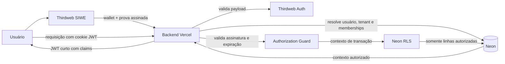
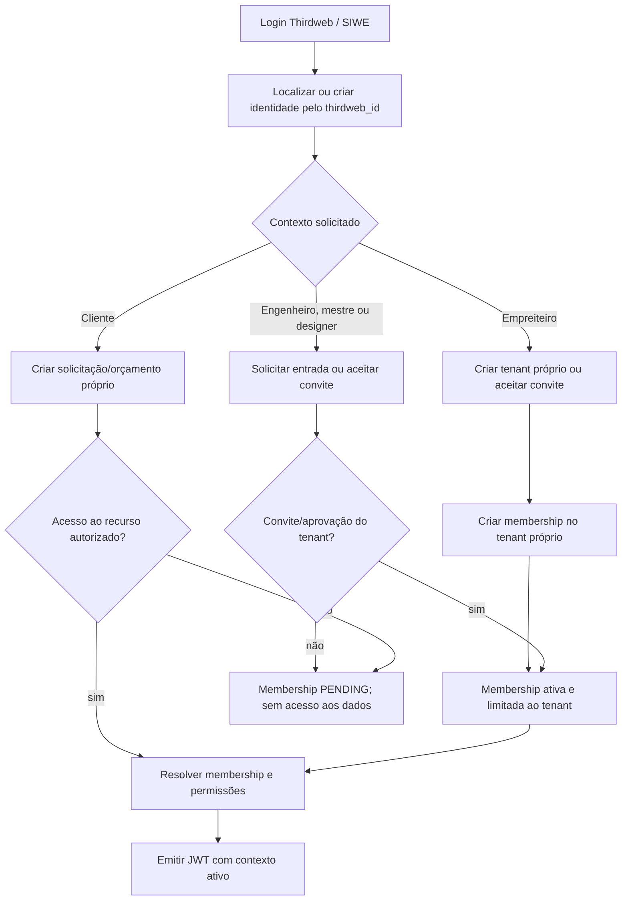
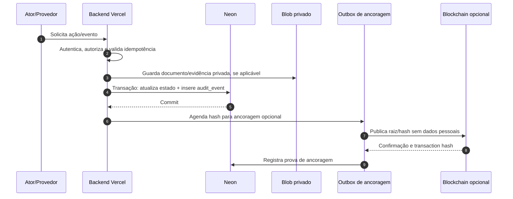

# ADR-0005: Autorização por JWT, Neon e Auditoria de Eventos

| Metadado | Valor |
| :--- | :--- |
| **Status** | 🟡 `Proposed` |
| **Data** | 2026-11-11 |
| **Autores** | Equipe ObraFlow |
| **Contexto** | Autenticação Thirdweb, autorização multi-tenant, registro auditável de eventos e assinaturas |
| **Decisões Relacionadas** | [ADR-0004](./0004-adr-migracao-neon-db-infra-vercel.md) |

## 1. Contexto

O ObraFlow precisa autenticar usuários com Thirdweb, aplicar rapidamente regras por perfil/organização/obra e manter evidências auditáveis de etapas importantes da obra: aprovação de orçamento, pagamento, contrato, evidências de execução, conclusão e garantia.

A proposta anterior de consultar a blockchain em cache miss e manter um cache Redis para autorizar requisições gerais foi considerada mais complexa do que o necessário. As operações normais do SaaS não dependem de propriedade de ativos on-chain. Direitos de negócio e segregação de dados devem acompanhar os vínculos e permissões do usuário no Neon.

## 2. Decisão

Adotar os seguintes componentes:

- **Thirdweb SIWE:** prova de controle da wallet e autentica a identidade.
- **JWT de sessão assinado pelo backend via Thirdweb Auth:** carrega um snapshot curto do contexto de autorização.
- **Neon:** fonte de verdade para usuários, tenants, memberships, perfis, permissões e eventos de negócio.
- **Neon Row-Level Security (RLS):** reforça o isolamento de linhas por tenant/projeto.
- **Blockchain:** opcional para assinaturas estruturadas, operações que realmente exigem estado on-chain e ancoragem de hashes de auditoria.
- **Redis:** fora do caminho padrão de autorização; poderá ser avaliado futuramente apenas se métricas mostrarem necessidade concreta.

O fluxo de autenticação Thirdweb documenta a verificação de um payload SIWE e a emissão de um JWT pelo servidor. O Thirdweb Auth permite adicionar contexto customizado ao JWT. [Thirdweb Auth para Next.js](https://portal.thirdweb.com/wallets/auth/frameworks/next), [API `createAuth`](https://portal.thirdweb.com/typescript/v5/createAuth)

### Arquitetura



## 3. Jornada de cadastro e concessão de acesso

A escolha de perfil no cadastro informa o contexto pretendido. Ela não concede, sozinha, acesso a uma organização ou obra existente.



Regras iniciais:

- Uma identidade Thirdweb pode ter vários memberships e perfis em tenants diferentes.
- `CLIENT` pode iniciar uma solicitação própria; acesso a uma obra existente requer associação explícita.
- `CONTRACTOR` pode criar e administrar seu próprio tenant; para entrar em tenant existente precisa de convite.
- `ENGINEER`, `FOREMAN` (mestre de obras) e `DESIGNER` precisam de convite ou aprovação do tenant para acessar obras.
- `PLATFORM_ADMIN` é provisionado por processo interno e nunca pode ser escolhido no cadastro.
- Memberships em `PENDING`, `SUSPENDED` ou `REVOKED` não recebem permissões de negócio no JWT.

## 4. Claims do JWT de sessão

O backend emite o JWT após validar o payload Thirdweb e resolver o membership ativo no Neon. `sub` identifica a wallet autenticada. O perfil pertence ao membership ativo, não ao usuário de forma global.

Claims iniciais:

```json
{
  "sub": "0xabc123",
  "user_id": "usr_123",
  "tenant_id": "tenant_alpha",
  "membership_id": "member_456",
  "role": "ENGINEER",
  "permissions": [
    "project:read",
    "budget:read",
    "budget:update",
    "evidence:read"
  ],
  "authz_version": 7,
  "iat": 1794412800,
  "exp": 1794413400
}
```

Decisões para os claims:

- JWT inicial terá validade curta, com alvo de 10 minutos, configurável por ambiente.
- O usuário troca de tenant/contexto através do backend; o backend valida o membership escolhido e emite outro JWT.
- `permissions` deve conter apenas permissões necessárias ao contexto ativo.
- Não incluir uma lista irrestrita de todos os `project_ids`; o vínculo ao projeto será validado na consulta por RLS/membership.
- `authz_version` registra a versão do contexto na emissão. Para revogação imediata, a versão deve ser comparada com o estado atual no Neon; isoladamente, a claim não revoga tokens.
- O JWT será enviado em cookie `HttpOnly`, `Secure` em produção e `SameSite=Lax` ou mais restritivo, com proteção CSRF nas operações mutáveis.
- A chave de assinatura `AUTH_PRIVATE_KEY` será técnica, sem saldo nem permissões administrativas, e armazenada como secret server-side.

O token é um snapshot temporário. Alterações de perfil ou membership terão efeito em até a expiração do token para ações comuns. Ações críticas revalidarão o estado atual do membership dentro da mesma transação que altera o recurso.

## 5. Autorização e segregação no Neon

O modelo deverá separar identidade e memberships:

```text
users(id, thirdweb_id, wallet_address, status)
tenants(id, name, status)
tenant_memberships(user_id, tenant_id, role, status, authz_version)
projects(id, tenant_id, ...)
project_memberships(user_id, project_id, access_level, status)
role_permissions(role, resource, action)
```

O backend valida o JWT e define o contexto da transação. A implementação de RLS deve usar contexto transacional local, com o driver Neon escolhido validado para garantir que contexto e queries ocorram na mesma transação. Não usar variáveis de sessão persistentes em conexões pooladas.

Cada tabela de negócio terá `tenant_id` ou relação determinística com um projeto que pertença a um tenant. As policies negarão por padrão e considerarão tenant, membership ativo, vínculo com projeto e ação permitida. O tenant nunca será confiado a um valor livre enviado pelo frontend.

O usuário de runtime do Neon não poderá ignorar RLS, alterar schema ou usar a credencial de migrations. Operações críticas validarão membership e `authz_version` atuais dentro da transação, para que uma revogação recente não dependa apenas da expiração do JWT.

## 6. Registro auditável de eventos

Mudanças relevantes do workflow serão registradas em uma tabela append-only, por exemplo `audit_events`. A alteração de estado do recurso e a inserção do evento devem ocorrer na mesma transação Neon.

Campos mínimos:

```text
id, tenant_id, project_id, actor_user_id, actor_wallet,
actor_role, event_type, resource_type, resource_id,
occurred_at, recorded_at, request_id, idempotency_key,
source, external_event_id, document_hash, metadata_redacted
```

O papel do evento é registrar quem fez o quê, em qual recurso, sob qual tenant e com qual evidência. Eventos não serão atualizados ou apagados pela aplicação; uma correção será outro evento compensatório. Payloads não devem conter chaves, dados de pagamento completos, documentos ou dados pessoais desnecessários.

A role de runtime terá somente `SELECT` e `INSERT` em `audit_events`; permissões de `UPDATE` e `DELETE` ficarão fora das credenciais de runtime. Migrations e manutenção administrativa usarão credenciais separadas e auditadas.



### Eventos e respectivas fontes de confirmação

| Evento | Fonte que confirma o resultado | Evidência armazenada |
| :--- | :--- | :--- |
| Orçamento aprovado | Ação autorizada do usuário e assinatura registrada | Versão/hash do orçamento, autor, valor, timestamp, nonce e assinatura |
| Pagamento PIX/Stripe | Webhook autenticado do PSP, processado uma única vez | PSP, event/payment ID, status, valor e timestamps; nunca confiar no redirect do browser |
| Contrato assinado | Plataforma de assinatura escolhida ou assinatura acordada pelas partes | PDF final em storage privado, hash, signatários e trilha de assinatura |
| Evidência de tarefa | Upload autorizado e posterior decisão de aceite, se exigida | Arquivo privado, hash, tarefa, autor e tempos de captura/upload/aceite |
| Conclusão da obra | Workflow de aceite e assinaturas dos responsáveis | Termo/versionamento, hashes, signatários e timestamps |
| Garantia acionada | Solicitação registrada e transições posteriores | Solicitante, item, prazo, evidências, responsável e status |

Stripe/PIX são pagamentos fora da blockchain; o webhook autenticado do respectivo provedor é a fonte de confirmação. Se futuramente houver pagamento on-chain, a transação confirmada será registrada como fonte para esse método específico.

## 7. Assinaturas e uso da blockchain

### 7.1. Aprovação e assinatura estruturada

Para uma aprovação que precise de prova da wallet, o usuário poderá assinar dados estruturados EIP-712, por exemplo:

```text
BudgetApproval {
  tenantId,
  projectId,
  quoteVersion,
  quoteHash,
  amount,
  currency,
  nonce,
  deadline
}
```

A assinatura e a mensagem verificável serão armazenadas no Neon junto do evento de auditoria. O nonce deve ser de uso único e a mensagem deve ter prazo; o EIP-712 define a assinatura de dados estruturados, mas não fornece proteção contra replay por si só. [EIP-712](https://eips.ethereum.org/EIPS/eip-712)

Uma assinatura EIP-712 pode ser validada sem uma transação on-chain. Isso comprova que a wallet assinou os dados. Para contratos formais, a adequação da wallet como mecanismo de assinatura e a identificação/capacidade de representação do signatário devem ser avaliadas juridicamente. Quando necessário, usar uma plataforma de assinatura eletrônica com identidade e trilha de evidência apropriadas, armazenando o documento final privadamente.

### 7.2. Ancoragem on-chain

Blockchain será usada quando houver uma necessidade concreta de prova verificável por terceiros ou de execução de contrato. A primeira opção para auditoria é ancorar periodicamente uma raiz Merkle ou hash de eventos, mantendo documentos e detalhes no storage privado e no Neon.

- Não registrar em blockchain nomes, e-mails, CPF/CNPJ, endereços de obra, conteúdo de documentos, fotos ou detalhes de pagamento.
- Guardar no Neon a prova de inclusão, identificador de lote, chain, contrato, bloco e transaction hash.
- Usar outbox e retries idempotentes para publicar a âncora sem bloquear a transação principal do workflow.
- Aguardar confirmação apropriada da chain antes de apresentar ancoragem como concluída.
- Assinatura de wallet e ancoragem de hash são provas técnicas complementares; não substituem automaticamente a trilha de assinatura ou requisitos jurídicos do documento.

## 8. Alternativas consideradas

| Opção | Vantagem | Limitação | Resultado |
| :--- | :--- | :--- | :--- |
| Consulta on-chain + Redis para cada direito | Atualização rápida de estado on-chain e cache veloz | Redis, invalidação por evento, RPC, TTL e novos pontos de falha em todo fluxo | Não usar no caminho comum |
| JWT curto com claims e memberships/RLS no Neon | Fluxo comum simples, baixo número de dependências e regras no banco | Claims são snapshot até expiração; requer revalidação das ações críticas | Escolhida |
| JWT totalmente stateless, sem memberships/RLS | Menos consultas e implementação inicial curta | Revogação atrasada e risco maior de acesso cross-tenant | Rejeitada para dados de negócio |
| Registrar cada evento integralmente on-chain | Trilha pública e difícil de alterar | Custo, privacidade e exposição de metadados; não confirma pagamentos off-chain | Rejeitada como padrão |
| Eventos append-only no Neon + assinatura/âncora seletiva | Auditoria operacional completa e prova pública opcional | Exige outbox e política de retenção/backup | Escolhida |

## 9. Health checks e testes obrigatórios

### Health checks

- `/api/health/thirdweb`: valida configuração de autenticação sem transação;
- `/api/health/neon`: valida conexão, versão de schema e consulta mínima;
- `/api/health/authorization`: valida configuração de RLS e policy usando dados de teste isolados;
- `/api/health/audit`: valida inserção idempotente em namespace de teste e leitura do evento;
- `/api/health/blockchain`: somente quando feature on-chain estiver habilitada; leitura sem mutação;
- `npm run test:health`: executa as verificações compatíveis com o ambiente local/preview.

Health checks não devem revelar claims, tenants, dados, topology interna ou secrets.

### Testes

- token ausente, expirado ou inválido retorna `401`;
- seleção de perfil no cadastro não concede acesso a tenants existentes;
- membership pendente/suspensa/revogada não acessa dados;
- troca de tenant emite sessão para membership validado;
- tenant A não lê nem altera dados do tenant B;
- acesso a projeto exige membership válido;
- alteração de role/membership é aplicada em até o prazo do JWT e operações críticas consultam o estado atual;
- o contexto de RLS não vaza entre requisições pooladas;
- aprovação repetida com a mesma idempotency key não duplica evento;
- webhook de pagamento inválido ou repetido não duplica confirmação;
- assinatura EIP-712 com nonce expirado ou reutilizado é rejeitada;
- hash do documento assinado corresponde à versão armazenada;
- upload/evidência é privado e vinculado a tenant/projeto/tarefa;
- publicação/ancoragem falha sem alterar ou apagar o evento original;
- tokens, documentos e dados sensíveis não aparecem em logs ou na blockchain.

## 10. Plano de implementação

1. Modelar `tenant_memberships`, `project_memberships`, permissões e status de aprovação; migrar os perfis atuais para memberships e revisar vínculos sem tenant/projeto inequívoco antes de conceder acesso.
2. Implementar login Thirdweb/SIWE e emissão de JWT curto com claims do membership ativo.
3. Implementar troca de tenant e fluxo de convite/aprovação de perfis.
4. Aplicar RLS e testar isolamento com o driver Neon e contexto transacional escolhidos.
5. Criar `audit_events` append-only e gravar eventos junto das transições de estado.
6. Validar e processar webhooks PIX/Stripe de forma autenticada e idempotente.
7. Implementar assinatura EIP-712 para aprovações que exigirem prova da wallet.
8. Definir plataforma de assinatura de contrato e armazenamento privado dos documentos.
9. Implementar outbox e ancoragem de hashes somente se aprovada para uma necessidade concreta.
10. Executar testes de health, identidade, autorização, auditoria, pagamentos e falhas antes da promoção.

## 11. Consequências

### Positivas

- Sem Redis no caminho normal de autorização.
- Um usuário pode ter papéis diferentes em tenants diferentes.
- A seleção inicial de perfil não concede acesso indevido.
- Neon aplica segregação de dados e mantém permissões consultáveis/auditáveis.
- Pagamentos, documentos e workflow possuem registros de auditoria com fonte de confirmação definida.
- Blockchain pode fornecer assinatura verificável ou prova de integridade sem guardar dados privados on-chain.

### Trade-offs

- Claims podem permanecer válidas até a expiração; por isso a sessão é curta e ações críticas revalidam membership.
- RLS e transações precisam ser implementadas e testadas cuidadosamente.
- Assinaturas on-chain e ancoragem exigem gestão de chain, custos e disponibilidade de RPC.
- A escolha de assinatura para contratos de prestação de serviço requer validação jurídica para o caso de uso.

## 12. Referências

- [Thirdweb Auth para Next.js](https://portal.thirdweb.com/wallets/auth/frameworks/next)
- [Thirdweb `createAuth`](https://portal.thirdweb.com/typescript/v5/createAuth)
- [EIP-712: Typed structured data hashing and signing](https://eips.ethereum.org/EIPS/eip-712)
- [Lei nº 14.063/2020](https://www.planalto.gov.br/ccivil_03/_ato2019-2022/2020/lei/l14063.htm)
- [ADR-0004](./0004-adr-migracao-neon-db-infra-vercel.md)
