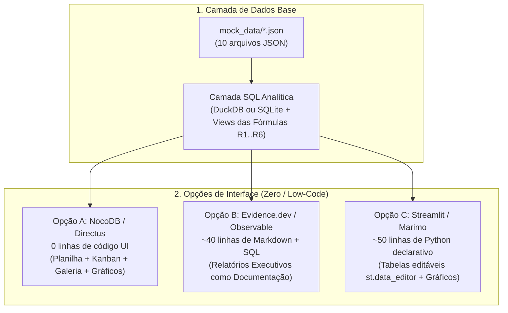

# RFC-0001: Estratégia de Prototipagem de Dados e Visualização de Relatórios (Minimal-Code)

| Metadado | Valor |
| :--- | :--- |
| **RFC ID** | `RFC-0001` |
| **Título** | Estratégia de Prototipagem de Dados e Visualização de Relatórios (Minimal-Code) |
| **Status** | 🔵 `Accepted` (Aprovada — Opção B: Evidence.dev + DuckDB) |
| **Data de Criação** | 2026-10-24 |
| **Autores** | Equipe ObraFlow |
| **Documentos Base** | [MER.md](../MER.md), [ACTORS.md](../ACTORS.md), [README.md](../README.md), [mock_data/](../mock_data) |

---

## 1. Sumário Executivo

Esta RFC define a estratégia técnica para **prototipar cenários de dados e visualizar os relatórios analíticos** especificados no [MER.md](../MER.md) utilizando a **menor quantidade possível de código**. Em vez de desenvolver telas customizadas do zero nesta fase, propomos utilizar ferramentas declarativas ou *No-Code Database UIs* acopladas a *Views SQL* sobre a massa de testes em [mock_data/](../mock_data).

---

## 2. Contexto e Motivação

O modelo de dados do **ObraFlow** ([MER.md](../MER.md)) abrange **10 entidades inter-relacionadas**:
* **Núcleo Comercial e Acesso:** `users`, `projects`
* **ERP do Empreiteiro:** `collaborators`, `payrolls`, `financial_transactions`
* **Motor de Execução e Logística:** `epics`, `tasks`, `materials`, `evidences`
* **Inovação em Acabamentos:** `ai_room_simulations`

Antes de iniciar a codificação completa da aplicação em **Next.js + Drizzle ORM + PostgreSQL**, precisamos validar visualmente se as regras de cálculo e os relatórios fazem sentido para os atores do sistema ([ACTORS.md](../ACTORS.md)). Escrever HTML/JS manual ou construir todo o frontend definitivo agora geraria código extenso e difícil de alterar durante os testes de modelagem.

---

## 3. Requisitos e Restrições

### 3.1. Requisitos de Negócio Mapeados do `MER.md`

| ID | Regra / Relatório do `MER.md` | Entidades Envolvidas | Regra de Cálculo / Exibição |
| :--- | :--- | :--- | :--- |
| **R1** | **Peso da EAP Expandido** *(Seção 3.1)* | `tasks`, `materials`, `ai_room_simulations` | `C_tarefa = cost_labor + (quantity * unit_price) + freight_cost + receiving_fee + consulting_fee` |
| **R2** | **Avanço Físico Comprovado** *(Seção 3.2)* | `tasks`, `evidences` | Soma do `C_tarefa` apenas das tarefas com `kanban_status = 'DONE'` **e** pelo menos 1 foto em `evidences`, dividido pelo Custo Total do Projeto. |
| **R3** | **Termômetro Físico vs. Financeiro** *(Seções 3.3 e 3.4.3)* | `epics`, `tasks`, `materials`, `financial_transactions` | Compara `% Físico` vs. `% Financeiro` global e por Épico, explicando desvios causados por compra antecipada de materiais em estoque/trânsito. |
| **R4** | **Cronograma de Compras + IA** *(Seção 3.4.1)* | `epics`, `tasks`, `materials`, `ai_room_simulations` | Alerta em vermelho materiais com `purchased = false` cujo `purchase_deadline` vence em $\le 7$ dias; exibe gatilho de simulação IA para `FINISHINGS`, `LIGHTING` e `DRYWALL`. |
| **R5** | **Kanban Polimórfico** *(Seção 3.4.2)* | `tasks`, `collaborators`, `materials`, `evidences` | Agrupamento por `kanban_status` (`TODO`, `IN_PROGRESS`, `REVIEW`, `DONE`) com filtro dinâmico por `category` (`EXECUTION`, `MATERIAL_RECEIVING`, `MATERIAL_PURCHASE`, `INSPECTION`). |
| **R6** | **Margem e Fluxo de Caixa** *(Seção 3.3)* | `financial_transactions`, `payrolls` | Exclusivo do Empreiteiro: `Receita Recebida (CLIENT_INSTALLMENT + AI_PROTOTYPING) - Saídas (MATERIAL + FREIGHT + RECEIVING_FEE + PAYROLL)`. |

### 3.2. Restrições Técnicas e Não-Objetivos
* **Mínimo Absoluto de Código:** Não escrever HTML, CSS ou lógica imperativa de manipulação de DOM.
* **Sem Infraestrutura Pesada:** Deve rodar localmente a partir dos arquivos em [mock_data/](../mock_data).
* **Fora de Escopo:** Autenticação real via Privy, armazenamento em nuvem via Vercel Blob e deploy em produção.

---

## 4. Opções Avaliadas (Arquiteturas Candidatas)



---

### 4.1. Opção A: NocoDB (ou Directus) sobre SQLite Local
Transforma um arquivo SQLite gerado a partir do `mock_data/` em uma interface completa estilo **Airtable / Notion** rodando localmente.

* **Funcionamento:**
  * Importação direta das 10 tabelas de `mock_data/` + criação de *Views SQL* para os relatórios `R1` a `R6`.
  * Na interface web do NocoDB/Directus, criamos sem código:
    * **Visão Kanban** na tabela `tasks` agrupada por `kanban_status` e filtrada por `category`.
    * **Visão Galeria** nas tabelas `evidences` e `ai_room_simulations` para visualizar fotos de campo e renders IA.
    * **Visão Grid/Planilha** para alterar qualquer valor e ver as *Views SQL* de relatórios atualizarem instantaneamente.
* **Prós:** Zero código de frontend; Kanban drag-and-drop real; edição de dados relacional pronta.
* **Contras:** Configuração visual feita no navegador (menos "versionável" em texto puro do que um arquivo Markdown, embora o banco/config possa ser salvo).

---

### 4.2. Opção B: Evidence.dev + DuckDB (BI-as-Code em Markdown)
Usa o motor **DuckDB** (que lê arquivos `.json` diretamente via SQL) combinado com componentes visuais declarativos em **Markdown**.

* **Funcionamento:**
  * Os relatórios são escritos como páginas `.md` onde cada seção possui uma query SQL sobre `mock_data/*.json` seguida de uma tag como `<BarChart />`, `<BigValue />` ou `<DataTable />`.
* **Exemplo de código necessário para um relatório:**
  ```markdown
  <BigValue data={resumo_obra} value="avanco_fisico_pct" title="Avanço Físico" />
  <BigValue data={resumo_obra} value="avanco_financeiro_pct" title="Avanço Financeiro" />
  <BarChart data={avanco_por_epico} x="epico" y={["fisico", "financeiro"]} type="grouped" />
  <DataTable data={cronograma_compras} />
  ```
* **Prós:** Alinhado 100% com a cultura de documentação em Markdown do repositório; código mínimo e legível; lê os arquivos `mock_data/*.json` direto sem etapa de conversão.
* **Contras:** Focado em leitura de relatórios (para testar novos dados, você edita o arquivo `.json` no VS Code/editor e a página recarrega sozinha via *hot-reload*).

---

### 4.3. Opção C: Streamlit (ou Marimo) + DuckDB (Data App em Python)
Um script Python único (~50 linhas) que usa **DuckDB** para consultar os JSONs e componentes declarativos (`st.data_editor`, `st.metric`, `st.bar_chart`) para exibir e editar dados na mesma tela.

* **Funcionamento:**
  * Exibe os arquivos de `mock_data/` dentro de componentes `st.data_editor` (planilha editável no navegador).
  * Sempre que uma célula é editada (ex: marcar `purchased = true`), o DuckDB reexecuta as queries SQL em memória e redesenha os gráficos de Saúde da Obra e Fluxo de Caixa.
* **Prós:** Permite editar os dados na própria tela e ver o recálculo em tempo real com ~50 linhas de código.
* **Contras:** Não possui quadro Kanban drag-and-drop nativo sem plugins adicionais; requer ambiente Python local.

---

### 4.4. Alternativa Descartada: HTML/JS Customizado ou Aplicação Next.js Completa
* **Motivo do Descarte:** Exige centenas de linhas de código imperativo de interface (HTML/Tailwind/JS) para replicar tabelas, filtros e gráficos que ferramentas de dados já entregam prontos.

---

## 5. Matriz Comparativa (Trade-offs)

| Critério de Avaliação | Opção A: **NocoDB / Directus** | Opção B: **Evidence.dev + DuckDB** | Opção C: **Streamlit + DuckDB** |
| :--- | :---: | :---: | :---: |
| **Volume de Código Escrito** | **0 linhas de UI** (+ ~30 linhas SQL) | **~40 linhas** (Markdown + SQL) | **~50 linhas** (Python + SQL) |
| **Leitura Direta do `mock_data/*.json`** | Requer importação p/ SQLite | ✅ Nativa (DuckDB lê JSON direto) | ✅ Nativa (DuckDB lê JSON direto) |
| **Kanban Polimórfico (`R5`)** | ✅ Nativo (Cards + Drag & Drop) | ⚠️ Apenas Tabela Filtrada | ⚠️ Apenas Tabela Filtrada |
| **Gráficos e Termômetro (`R1..R4`, `R6`)** | ✅ Widgets Visuais + Views SQL | ✅ Gráficos Executivos em 1 linha | ✅ Gráficos Interativos em 1 linha |
| **Edição de Dados p/ Simulação** | ✅ Planilha visual no navegador | Edição nos arquivos `.json` | ✅ Planilha `st.data_editor` |
| **Reaproveitamento na Stack Final** | As *Views SQL* vão p/ o Postgres | As *Queries SQL* vão p/ o Postgres | As *Queries SQL* vão p/ o Postgres |

---

## 6. Proposta Recomendada e Plano de Execução

Independentemente do visualizador escolhido (A, B ou C), **100% da inteligência dos relatórios do ObraFlow pode ser expressa em 4 Views SQL puras** (menos de 40 linhas de SQL no total):

1. `vw_eap_tasks`: Calcula o `C_tarefa` expandido (`R1`) e verifica se a tarefa está fisicamente comprovada com foto (`R2`).
2. `vw_project_health`: Consolida o `% Avanço Físico` vs. `% Avanço Financeiro` por Épico e Global (`R3`).
3. `vw_supply_chain_alerts`: Lista materiais pendentes ordenados por `purchase_deadline`, calculando dias restantes para alerta de gargalo ($\le 7$ dias) e elegibilidade de IA (`R4`).
4. `vw_contractor_cashflow`: Consolida entradas, saídas por categoria e margem líquida do empreiteiro (`R6`).

### Plano de Implementação em 2 Passos Curtos:
1. **Passo 1 (Camada Analítica Mínima):** Criar um único arquivo SQL (`sql/views_relatorios.sql`) que lê os arquivos de [mock_data/](../mock_data) e materializa as 4 visões acima.
2. **Passo 2 (Camada Visual):** Conectar a ferramenta escolhida na Seção 7 (**Opção A, B ou C**) diretamente sobre essas 4 Views.

---

## 7. Decisão Final Registrada

* **Decisão Aprovada (2026-10-24):** Adotar a **Opção B: Evidence.dev + DuckDB (Abordagem Markdown + SQL / BI-as-Code)**.
* **Arquitetura de Arquivos do Protótipo:**
  * `sources/obraflow/`: Conector DuckDB lendo diretamente os 10 arquivos `.json` de `mock_data/` via `read_json_auto()`.
  * `pages/index.md`: Página única em Markdown declarativo contendo as consultas SQL dos relatórios `R1` a `R6` e os componentes nativos do Evidence (`<BigValue>`, `<BarChart>`, `<DataTable>`).
