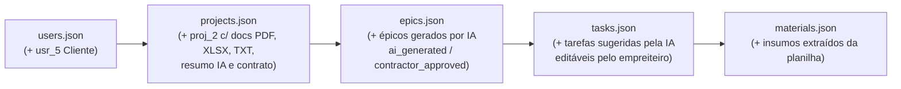

# Plano de Implementação — ADR e Protótipo Interativo da Jornada de Orçamento, Contrato e EAP via IA

## Objetivo

Criar uma **ADR / RFC (`rfcs/0002-adr-jornada-orcamento-contrato-ia.md`)** e implementar, sobre a base atual em **Evidence.dev + DuckDB**, a prototipagem interativa de ponta a ponta da jornada de onboarding e estruturação de obras por IA utilizando os dados de [`mock_data/`](file:///Users/govinda/projetos/ObraFlow/mock_data) e a interface em [`pages/index.md`](file:///Users/govinda/projetos/ObraFlow/pages/index.md), **sem duplicar queries ou componentes visuais**.

O fluxo prototipado cobre as **8 etapas solicitadas**:
1. **Criação de Usuário** (`CLIENT` / `CONTRACTOR` / `ENGINEER`).
2. **Criação e Preenchimento de Novo Orçamento** (dados da obra, área $\text{m}^2$, endereço, teto estimado e escopo preliminar).
3. **Envio da Documentação da Obra** (upload/anexo de arquivos **PDF**, **Planilha `.xlsx/.csv`** e **Texto `.txt`**).
4. **Processamento dos Dados por IA** (leitura multimodal dos 3 formatos de arquivo, extração de quantitativos, estimativa de custos e score de confiança).
5. **Criação do Contrato** (geração automática da minuta contratual com cláusulas de medição por evidência fotográfica, logística e valor EAP).
6. **Aceite do Contrato pelo Cliente** (assinatura/aceite digital registrando `contract_signed_at` e destravando a geração da obra).
7. **Criação da Obra com Épicos e Tarefas pela IA** (geração automática da Master Pipeline de `epics` e decomposição em `tasks` no Kanban com custos e prazos).
8. **Aprovação ou Edição de Épicos e Tarefas pelo Empreiteiro** (interface interativa para o empreiteiro editar títulos, custos de mão de obra, prazos, categorias ou adicionar/aprovar itens antes de liberar a execução).

---

## Revisão Necessária (Decisões de Design)

> [!IMPORTANT]
> **Princípio DRY (Zero Duplicação de Código) e Simplicidade Mínima**
> Em vez de criar páginas separadas com queries SQL duplicadas ou introduzir novos frameworks, utilizaremos a própria capacidade reativa do **Evidence.dev (Svelte + DuckDB WASM)** dentro de [`pages/index.md`](file:///Users/govinda/projetos/ObraFlow/pages/index.md):
> 1. **Seletor Global de Obra (`projeto_ativo`)**: Todas as queries analíticas existentes em `pages/index.md` (`eap_por_tarefa`, `kpis_globais`, `cronograma_epicos`, `kanban_cards`, `saude_por_epico`, `cronograma_compras`, `extrato_financeiro`) passarão a filtrar dinamicamente pelo projeto selecionado, reaproveitando **100% do dashboard atual** para qualquer obra.
> 2. **Simulador Interativo da Jornada IA (8 Etapas)**: Integrado no topo do dashboard (com estados reativos inicializados a partir do `mock_data/`), permitindo testar em tempo real o preenchimento de dados, seleção de arquivos `.pdf` / `.xlsx` / `.txt`, extração IA, aceite do contrato pelo cliente e edição inline de Épicos/Tarefas pelo empreiteiro com recálculo instantâneo do orçamento.
> 3. **Colunas Escalares no `mock_data/`**: Para manter compatibilidade total com o conector DuckDB/Parquet do Evidence (`read_json_auto`), os novos atributos de orçamento, documentos (`doc_pdf_name`, `doc_spreadsheet_name`, `doc_txt_name`), resumo da IA e flags de aprovação (`ai_generated`, `contractor_approved`) serão adicionados como campos escalares planos nos arquivos existentes de `mock_data/`.

---

## Mudanças Propostas

### 1. Documentação Arquitetural (ADR / RFC)

#### [NEW] [0002-adr-jornada-orcamento-contrato-ia.md](file:///Users/govinda/projetos/ObraFlow/rfcs/0002-adr-jornada-orcamento-contrato-ia.md)
* Segue o padrão oficial de [`rfcs/0000-template.md`](file:///Users/govinda/projetos/ObraFlow/rfcs/0000-template.md) e [`rfcs/0001-prototipagem-dados-e-relatorios.md`](file:///Users/govinda/projetos/ObraFlow/rfcs/0001-prototipagem-dados-e-relatorios.md).
* Documenta:
  * **Contexto:** Necessidade de validar o funil comercial e de onboarding assistido por IA (`QUOTE_REQUESTED` $\rightarrow$ `AI_ANALYZING` $\rightarrow$ `BUDGET_READY` $\rightarrow$ `APPROVED` $\rightarrow$ `CONTRACT_SIGNED` $\rightarrow$ `IN_PROGRESS`) definido no [`MER.md`](file:///Users/govinda/projetos/ObraFlow/MER.md).
  * **Opções Avaliadas:**
    * *Opção 1:* Múltiplas páginas estáticas por etapa (descartada por duplicar SQL e não oferecer edição interativa fluida).
    * *Opção 2:* Backend customizado com banco transacional separado (descartada por violar a restrição *Minimal-Code* e o deploy estático no GitHub Pages).
    * *Opção 3 (Escolhida):* **State-Machine Reativa + Parametrização SQL sobre `mock_data/` no Evidence.dev** — combina dados semente estruturados em `mock_data/` com estado reativo Svelte/Evidence em uma única página parametrizada (`pages/index.md`).
  * **Diagrama de Máquina de Estados (Mermaid)** cobrindo os 8 passos entre Cliente, IA e Empreiteiro.
  * **Extensão do Modelo de Dados (`mock_data`)** sem quebra de compatibilidade.

#### [MODIFY] [README.md](file:///Users/govinda/projetos/ObraFlow/rfcs/README.md)
* Adicionar a entrada da `RFC-0002` na tabela de índice de RFCs/ADRs.

---

### 2. Evolução da Massa de Dados (`mock_data/`)

Enriqueceremos os arquivos existentes em [`mock_data/`](file:///Users/govinda/projetos/ObraFlow/mock_data) com um segundo cenário completo de obra (**`proj_2` — "Loft Jardins (Orçamento & Onboarding IA)"**) além do **`proj_1` — "Residencial Alpha"** já existente:

#### [MODIFY] [users.json](file:///Users/govinda/projetos/ObraFlow/mock_data/users.json)
* Adicionar `usr_5` (`Marina Costa (Proprietária Loft)`, `role: "CLIENT"`) representando o usuário recém-cadastrado no fluxo de prototipagem.

#### [MODIFY] [projects.json](file:///Users/govinda/projetos/ObraFlow/mock_data/projects.json)
* Adicionar atributos escalares do fluxo comercial/IA em `proj_1` e criar `proj_2`:
  * `area_m2`: área da obra em $\text{m}^2$
  * `estimated_budget`: orçamento estimado/teto informado no pedido
  * `scope_notes`: descrição textual do orçamento preenchida pelo usuário
  * `doc_pdf_name`: nome do arquivo PDF enviado (ex: `"planta_executiva_loft.pdf"`)
  * `doc_spreadsheet_name`: nome da planilha enviada (ex: `"quantitativos_sinapi_loft.xlsx"`)
  * `doc_txt_name`: nome do memorial TXT enviado (ex: `"memorial_descritivo_acabamentos.txt"`)
  * `ai_analysis_summary`: diagnóstico estruturado extraído pela IA a partir dos 3 arquivos
  * `ai_confidence_pct`: índice de confiança da leitura da IA (ex: `96`)
  * `contract_terms_summary`: resumo das cláusulas geradas para o contrato
  * `client_accepted_contract`: booleano indicando o aceite do cliente
  * `contractor_approved_eap`: booleano indicando a revisão/aprovação final dos épicos e tarefas pelo empreiteiro

#### [MODIFY] [epics.json](file:///Users/govinda/projetos/ObraFlow/mock_data/epics.json)
* Adicionar campos `ai_generated` (`boolean`) e `contractor_approved` (`boolean`).
* Incluir os épicos gerados pela IA para `proj_2` (`epic_5`, `epic_6`, `epic_7`).

#### [MODIFY] [tasks.json](file:///Users/govinda/projetos/ObraFlow/mock_data/tasks.json)
* Adicionar campos `ai_generated` (`boolean`) e `contractor_approved` (`boolean`).
* Incluir as tarefas geradas pela IA para `proj_2` (`task_12` a `task_16`), permitindo demonstrar a revisão/edição pelo empreiteiro e alimentar os gráficos do dashboard quando `proj_2` é selecionado.

#### [MODIFY] [materials.json](file:///Users/govinda/projetos/ObraFlow/mock_data/materials.json) & [financial_transactions.json](file:///Users/govinda/projetos/ObraFlow/mock_data/financial_transactions.json)
* Incluir insumos e lançamentos iniciais vinculados ao `proj_2` (extraídos da planilha pela IA) para que todos os gráficos e tabelas do dashboard funcionem de forma consistente ao alternar entre `proj_1` e `proj_2`.

---

### 3. Interface Interativa Unificada (`pages/index.md`)

#### [MODIFY] [index.md](file:///Users/govinda/projetos/ObraFlow/pages/index.md)
* **Zero Duplicação de Código:**
  * Adicionar no topo o seletor de obra (`<Dropdown>` / `<ButtonGroup name="projeto_id">`) alimentado por `obraflow.projects`.
  * Parametrizar a CTE base `eap_por_tarefa` e as demais queries (`cronograma_epicos`, `margem_empreiteiro`, `cronograma_compras`, `simulacoes_ia`, `extrato_financeiro`) com `WHERE project_id = '${inputs.projeto_id}'`, eliminando qualquer necessidade de duplicar relatórios.
* **Módulo Interativo "Jornada de Onboarding, Orçamento IA, Contrato e Aprovação de EAP" (8 Passos em Stepper Interativo):**
  * Implementado diretamente na página usando estado reativo Svelte sincronizado com os dados do DuckDB (`obraflow.users`, `obraflow.projects`, `obraflow.epics`, `obraflow.tasks`):
    1. **Passo 1 — Criar / Selecionar Usuário:** Formulário rápido (Nome, E-mail, Papel `CLIENT` / `CONTRACTOR` / `ENGINEER`) que adiciona o usuário à lista ativa em memória ou seleciona um existente de `users.json`.
    2. **Passo 2 — Novo Orçamento e Preenchimento de Dados:** Inputs para Nome da Obra, Endereço, Área ($\text{m}^2$), Orçamento Teto ($\text{R\$}$) e Escopo Preliminar (`status = QUOTE_REQUESTED`).
    3. **Passo 3 — Envio da Documentação (PDF, Planilha, TXT):** Seletores de arquivo (`<input type="file" accept=".pdf,.xlsx,.csv,.txt">` + botões de preenchimento rápido com os arquivos do `mock_data`) exibindo o status de validação dos 3 documentos obrigatórios.
    4. **Passo 4 — Processamento por IA (`AI_ANALYZING` $\rightarrow$ `BUDGET_READY`):** Botão *"Processar Documentos com IA"* que executa a simulação de leitura do PDF + Planilha + TXT, exibindo os itens extraídos, o orçamento calculado pela IA e o índice de confiança.
    5. **Passo 5 — Criação do Contrato (`APPROVED`):** Geração automática da minuta de contrato consolidando partes (Cliente e Empreiteiro), valor total da EAP, cronograma e cláusula de evidência fotográfica obrigatória.
    6. **Passo 6 — Aceite do Contrato pelo Cliente (`CONTRACT_SIGNED`):** Checkbox e botão *"Assinar Digitalmente como Cliente"*, gravando timestamp de assinatura e liberando a geração operacional da obra.
    7. **Passo 7 — IA Cria a Obra com Épicos e Tarefas:** Visualização da estrutura gerada automaticamente pela IA (Épicos da Master Pipeline + Tarefas com categoria Kanban, prazo e custo de mão de obra estimado).
    8. **Passo 8 — Empreiteiro Edita ou Aprova Épicos e Tarefas (`IN_PROGRESS`):** Tabela interativa editável onde o Empreiteiro pode:
       * Editar **título do épico/tarefa**, **categoria Kanban**, **prazo (`due_date`)** e **custo de mão de obra (`cost_labor`)** com recálculo imediato do orçamento total da EAP;
       * Adicionar nova tarefa/épico ou aprovar individualmente/em lote (`contractor_approved = true`), mudando o status da obra para `IN_PROGRESS`.

---

## Plano de Verificação

### Testes Automatizados (Build & Sources)
1. Executar `npm run sources` para garantir que o DuckDB processe todos os arquivos `.json` de `mock_data/` sem erros de schema ou tipagem.
2. Executar `npm run build` para validar que o SvelteKit/Evidence compile [`pages/index.md`](file:///Users/govinda/projetos/ObraFlow/pages/index.md) sem erros de sintaxe SQL, Markdown ou Svelte.

### Verificação Visual e Funcional
1. Verificar a renderização do seletor de projetos alternando entre `Residencial Alpha (proj_1)` e `Reforma Loft Jardins (proj_2)` e validando que todos os KPIs, Gantt, Kanban, Supply Chain e Fluxo de Caixa atualizam sem duplicação de código.
2. Percorrer no navegador as 8 etapas do simulador interativo (criação de usuário $\rightarrow$ dados do orçamento $\rightarrow$ upload de PDF/planilha/TXT $\rightarrow$ processamento IA $\rightarrow$ geração de contrato $\rightarrow$ aceite do cliente $\rightarrow$ geração de épicos/tarefas pela IA $\rightarrow$ edição de valores/títulos e aprovação pelo empreiteiro).
