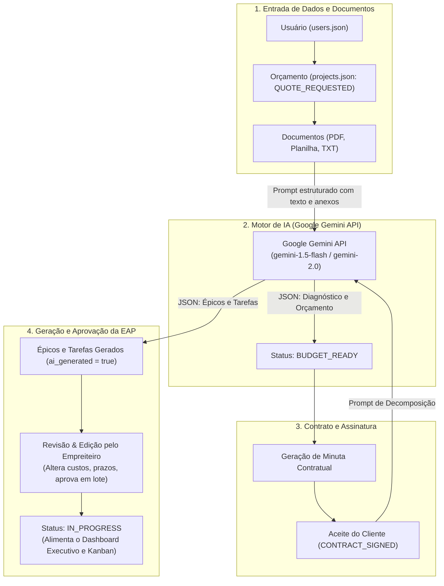

# RFC-0002: Arquitetura de Prototipagem da Jornada Comercial, Orçamento e EAP com IA (Minimal-Code)

| Metadado | Valor |
| :--- | :--- |
| **RFC ID** | `RFC-0002` |
| **Título** | Arquitetura de Prototipagem da Jornada Comercial, Orçamento e EAP com IA (Minimal-Code) |
| **Status** | 🔵 `Accepted` |
| **Data de Criação** | 2026-10-25 |
| **Autores** | Equipe ObraFlow |
| **Documentos Base** | [MER.md](../MER.md), [ACTORS.md](../ACTORS.md), [RFC-0001](./0001-prototipagem-dados-e-relatorios.md), [mock_data/](../mock_data) |

---

## 1. Sumário Executivo

Esta RFC define a arquitetura para prototipar a jornada de ponta a ponta de aquisição e estruturação de uma obra no **ObraFlow**: desde a criação de usuário e solicitação de orçamento, upload e processamento de documentos técnicos (PDF, Planilha, TXT) via Inteligência Artificial (**Google Gemini API**), até a formalização de contrato, geração automática da EAP (Épicos e Tarefas) e aprovação/edição pelo empreiteiro. A solução mantém o princípio **Minimal-Code** e **DRY (Don't Repeat Yourself)**, utilizando a infraestrutura declarativa existente em **Evidence.dev + DuckDB** em [`pages/index.md`](../pages/index.md) sem duplicar código nem infraestruturas pesadas.

---

## 2. Contexto e Motivação

Conforme estabelecido no [MER.md](../MER.md) e no [ACTORS.md](../ACTORS.md), o ciclo de vida do projeto compreende os seguintes estados formais:
`QUOTE_REQUESTED` $\rightarrow$ `AI_ANALYZING` $\rightarrow$ `BUDGET_READY` $\rightarrow$ `APPROVED` $\rightarrow$ `CONTRACT_SIGNED` $\rightarrow$ `IN_PROGRESS` $\rightarrow$ `COMPLETED`.

Antes de implementar o sistema transacional completo em Next.js + PostgreSQL + Drizzle ORM, é essencial validar a experiência do usuário e do empreiteiro:
1. Como o cliente insere os dados e envia arquivos heterogêneos (planta em PDF, planilha de custos, memorial em TXT).
2. Como uma IA de última geração lê esses insumos, extrai quantitativos, estima custos e gera a minuta de contrato.
3. Como o cliente assina digitalmente e a IA desdobra a obra em macroetapas (Épicos) e microetapas operacionais (Tarefas do Kanban).
4. Como o empreiteiro audita, altera custos de mão de obra e prazos antes de aprovar e dar início aos trabalhos de campo.

---

## 3. Requisitos e Restrições

### 3.1. Requisitos Funcionais
* **Etapa 1 — Criação/Seleção de Usuário:** Registro rápido de perfil (`CLIENT`, `CONTRACTOR`, `ENGINEER`).
* **Etapa 2 — Criação e Preenchimento de Orçamento:** Entrada dos dados da obra (nome, endereço, área $\text{m}^2$, valor teto orçamentário).
* **Etapa 3 — Upload de Documentação Técnica:** Suporte a arquivos PDF, Planilha (XLSX/CSV) e Texto (TXT).
* **Etapa 4 — Processamento por IA:** Integração com LLM (**Google Gemini API**) para analisar os documentos e retornar diagnóstico de viabilidade, quantitativos e sugestão de orçamento base.
* **Etapa 5 — Criação de Contrato:** Geração de minuta contratual vinculada ao escopo e regras de medição com comprovação fotográfica.
* **Etapa 6 — Aceite pelo Cliente:** Assinatura digital com gravação de data/hora (`contract_signed_at`).
* **Etapa 7 — Decomposição da Obra via IA:** Geração automática da árvore de Épicos (`epics`) e Tarefas (`tasks`) com categoria Kanban, custos planejados e prazos.
* **Etapa 8 — Auditoria e Aprovação pelo Empreiteiro:** Edição interativa de custos, prazos e títulos de tarefas, com recálculo instantâneo do valor da EAP e alteração de status para `IN_PROGRESS`.

### 3.2. Restrições Técnicas
* **Zero Duplicação de Código (DRY):** O dashboard executivo atual de relatórios e Kanban deve ser parametrizado pelo projeto ativo, compartilhando as mesmas queries analíticas para qualquer obra.
* **Compatibilidade Estática:** O protótipo deve continuar funcionando e compilando via `npm run build` para publicação estática no GitHub Pages.
* **Chamada Real à IA:** Utilização direta da API do Google Gemini via fetch no navegador, com chave configurável e fallback instantâneo alimentado por [`mock_data/`](../mock_data).

---

## 4. Arquitetura da Solução

---

## 5. Matriz Comparativa de Abordagens

| Critério | Backend Dedicado + DB | Múltiplas Páginas Estáticas | **State Machine Reativa + Gemini API (Escolhida)** |
| :--- | :---: | :---: | :---: |
| **Linhas de Código** | Alta complexidade (+1500 linhas) | Média (~600 linhas duplicadas) | **Mínima (~200 linhas declarativas)** |
| **Duplicação de Queries SQL** | Não | Alta (queries repetidas em cada página) | **Zero (queries SQL unificadas no `pages/index.md`)** |
| **Chamada Real à IA** | Sim | Simulação fixa | **Sim (Google Gemini com fallback semente)** |
| **Deploy GitHub Pages** | Requer servidor Node/Python | Sim | **Sim (100% estático com processamento client-side)** |

---

## 6. Decisão e Próximos Passos

Aprovada a implementação da abordagem **State Machine Reativa com chamada à API do Google Gemini** integrada na página principal [`pages/index.md`](../pages/index.md), acompanhada da ampliação da massa de dados em [`mock_data/`](../mock_data) com a inclusão do projeto `proj_2`.
